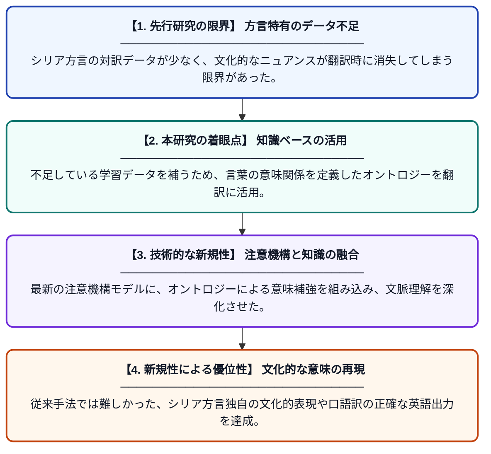

# 注意機構とオントロジー拡張を用いたシリア語・英語ニューラル機械翻訳

**Original Title**: *Syrian-English Neural Machine Translation Using Attention Mechanism and Ontology Enrichment*

> **💡 一言要約**: オントロジーでシリア方言の翻訳精度を劇的に向上！

| 項目 | 内容 |
|---|---|
| **著者** | C Al-Rakkad, MB Kurdy |
| **掲載誌** | Journal of Computer-Assisted Linguistic Research 2026 |
| **アラートキーワード** | Ontology |
| **PDF** | [https://polipapers.upv.es/index.php/jclr/article/download/26356/18957](https://polipapers.upv.es/index.php/jclr/article/download/26356/18957) |
| **原文リンク** | [https://polipapers.upv.es/index.php/jclr/article/download/26356/18957](https://polipapers.upv.es/index.php/jclr/article/download/26356/18957) |
| **PDF版要約** | [README.pdf](./README.pdf) |

---

## 📊 新規性の図解（先行研究との違いと本研究のブレークスルー）

## 📝 要約

本研究は、データの乏しいシリア方言アラビア語から英語への翻訳精度を向上させるため、ニューラル機械翻訳（NMT）に注意機構とオントロジーによる知識補強を導入しました。文化特有の表現を構造化された知識として組み込むことで、従来の手法では困難だった文脈に応じた翻訳を実現しています。

## ❓ どんな問題に取り組んだか

シリア方言のような口語アラビア語は、標準語と大きく異なる上に翻訳用の対訳データが極めて少ないという課題があります。また、方言特有の言い回しには文化的な背景が含まれるため、単純な機械翻訳では意味を正しく捉えきれないことが問題視されていました。

## ✨ 何が新しい？何がすごい？（新規性）

従来の注意機構（Attention）を用いたモデルに、語彙の意味関係を定義した「オントロジー」を統合し、知識ベースで学習データを強化した点が画期的です。単なる統計的な変換に頼らず、オントロジーを通じて文化的な概念や文脈をモデルに教え込むことで、低リソース言語における翻訳の質を大幅に向上させました。これにより、データ不足を知識で補うという、方言翻訳における新しいパラダイムを提示しています。

## 🎓 大学1年生向けの解説

シリアで日常的に話される言葉は、教科書のアラビア語とはかなり違っており、AIが翻訳するためのデータもあまりありません。この研究では、AIに「単語の並び方」を教えるだけでなく、「言葉同士がどういう意味で繋がっているか」という知識の地図（オントロジー）を与えました。これにより、AIはシリア独自の文化的な言い回しも理解できるようになり、より自然な英語に直せるようになりました。データの少ない難しい言葉でも、工夫次第で賢く翻訳できることを示した研究です。
