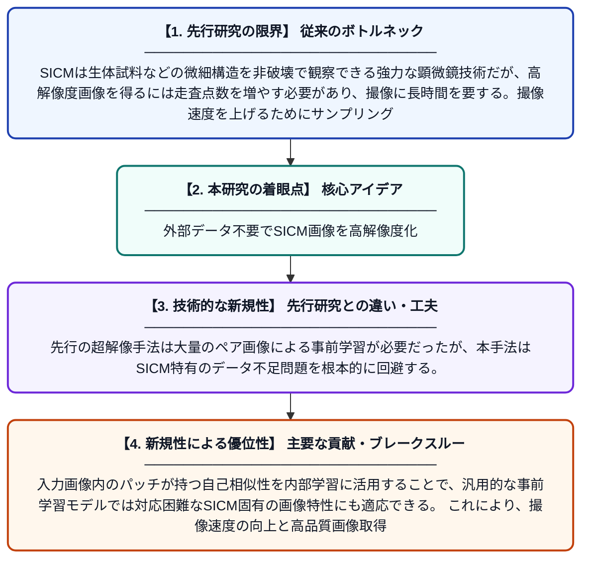

# ゼロショット学習に基づく超解像技術によるアンダーサンプリング走査型イオンコンダクタンス顕微鏡画像の再構成

**Original Title**: *Reconstruction of undersampled scanning ion conductance microscopy images through zero-shot learning-based super-resolution*

> **💡 一言要約**: 外部データ不要でSICM画像を高解像度化

| 項目 | 内容 |
|---|---|
| **著者** | J Li, X Shi, X Liao, W Wu, Y Cai |
| **掲載誌** | Micron 2026 |
| **アラートキーワード** | zero shot |
| **原文リンク** | [https://www.sciencedirect.com/science/article/pii/S0968432826001009](https://www.sciencedirect.com/science/article/pii/S0968432826001009) |
| **PDF版要約** | [README.pdf](./README.pdf) |

---

## 📊 新規性の図解（先行研究との違いと本研究のブレークスルー）

## 📝 要約

本論文では、走査型イオンコンダクタンス顕微鏡（SICM）で取得したアンダーサンプリング画像を高解像度に復元するゼロショット超解像フレームワークを提案する。ZSSR アルゴリズムに着想を得て、入力画像から切り出したパッチのみを用いて画像固有のネットワークを訓練する手法を採用しており、外部の学習データを必要としない点が特徴である。これにより、SICMの撮像速度を向上させながら高品質な画像を得ることが可能になる。

## ❓ どんな問題に取り組んだか

SICMは生体試料などの微細構造を非破壊で観察できる強力な顕微鏡技術だが、高解像度画像を得るには走査点数を増やす必要があり、撮像に長時間を要する。撮像速度を上げるためにサンプリング数を減らすと、画像品質が大幅に低下するというトレードオフが存在する。また、従来の深層学習による超解像手法はSICM専用の大規模な教師データセットを必要とし、実用上の障壁が高かった。

## ✨ 何が新しい？何がすごい？（新規性）

本研究の最大の新規性は、外部の学習データを一切使用せず、再構成対象の入力画像だけから画像固有ネットワークを訓練する「ゼロショット超解像」アプローチをSICMに初めて適用した点である。先行の超解像手法は大量のペア画像による事前学習が必要だったが、本手法はSICM特有のデータ不足問題を根本的に回避する。入力画像内のパッチが持つ自己相似性を内部学習に活用することで、汎用的な事前学習モデルでは対応困難なSICM固有の画像特性にも適応できる。これにより、撮像速度の向上と高品質画像取得の両立という実用的な目標を達成している。

## 🎓 大学1年生向けの解説

SICMとは、細胞や材料の表面の凸凹を非常に細かく測定できる特殊な顕微鏡です。高精細な画像を撮るには時間がかかりすぎるため、あえて荒く（少ない点数で）撮影し、後から画像をきれいに復元する技術が求められています。通常のAIを使った復元手法では、あらかじめ大量のお手本データで学習させる必要がありますが、この研究では撮影した1枚の画像だけを使ってAIが自己学習する「ゼロショット」という方法を採用しました。まるで、1枚の写真を観察するだけで絵の描き方を覚える職人のようなイメージです。これにより、専用のデータを用意しなくても高解像度なSICM画像を素早く得られるようになりました。
