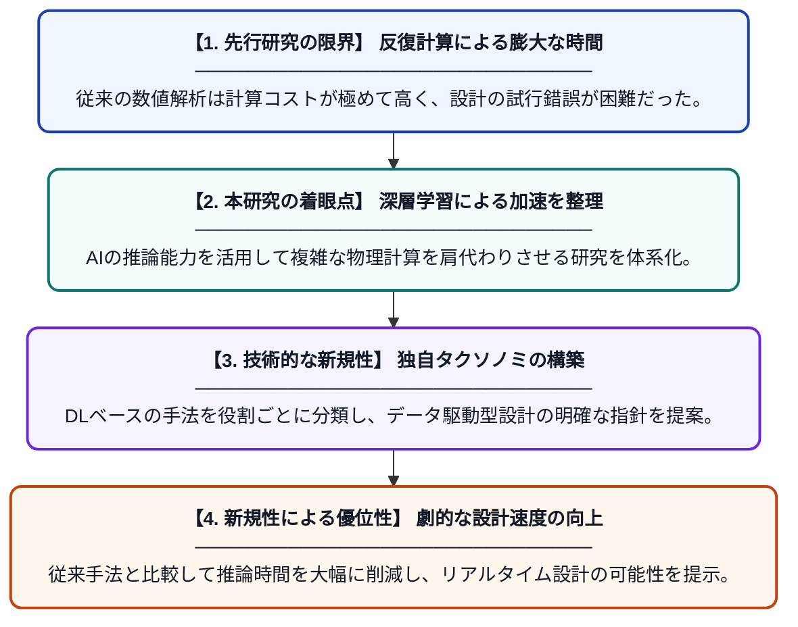

# トポロジー最適化におけるディープラーニング手法：系統的レビュー

**Original Title**: *Deep learning methods in topology optimization: A systematic review*

> **💡 一言要約**: AIでトポロジー最適化を劇的に高速化する技術の集大成

| 項目 | 内容 |
|---|---|
| **著者** | J Krejčí, J Pflugbeil, Z Zeman |
| **掲載誌** | Engineering Applications of Artificial Intelligence 2027 |
| **アラートキーワード** | optimization |
| **原文リンク** | [https://www.sciencedirect.com/science/article/pii/S0952197626029398](https://www.sciencedirect.com/science/article/pii/S0952197626029398) |
| **PDF版要約** | [README.pdf](./README.pdf) |

---

## 📊 新規性の図解（先行研究との違いと本研究のブレークスルー）

## 📝 要約

トポロジー最適化（TO）は強力な設計手法ですが、計算コストの高さが課題です。本論文は、ディープラーニング（DL）を適用したTO研究を網羅的に調査し、手法の分類体系（タクソノミ）を提案するとともに、従来手法に対する高速化の有効性を整理したレビュー論文です。

## ❓ どんな問題に取り組んだか

従来のトポロジー最適化は、物理シミュレーションを何度も繰り返すため膨大な計算時間を要し、リアルタイムの設計変更や複雑な課題への適用が困難でした。また、近年急増しているAI活用の手法について、体系的な整理や評価の基準が不足していました。

## ✨ 何が新しい？何がすごい？（新規性）

本研究は、DLベースのトポロジー最適化における膨大な論文群を「設計プロセスのどの段階にAIを使うか」という視点で分類する新たなタクソノミを提案しました。単なる手法紹介に留まらず、従来の反復計算とAI推論の速度差を定量的に比較し、将来の課題を明確化しています。特に、データ生成のコストとモデルの汎用性のトレードオフを浮き彫りにした点が重要な貢献です。

## 🎓 大学1年生向けの解説

「トポロジー最適化」とは、材料の強度を保ちつつ、最も軽くて丈夫な形をコンピュータに探させる技術です。これまではスーパーコンピュータで何時間も計算する必要がありましたが、最近ではAI（ディープラーニング）を使って一瞬で答えを出す研究が進んでいます。この論文は、世界中のAIを使った設計手法を調査して、「どのやり方が一番効率的か」をまとめた、研究者にとってのガイドブックのようなものです。
