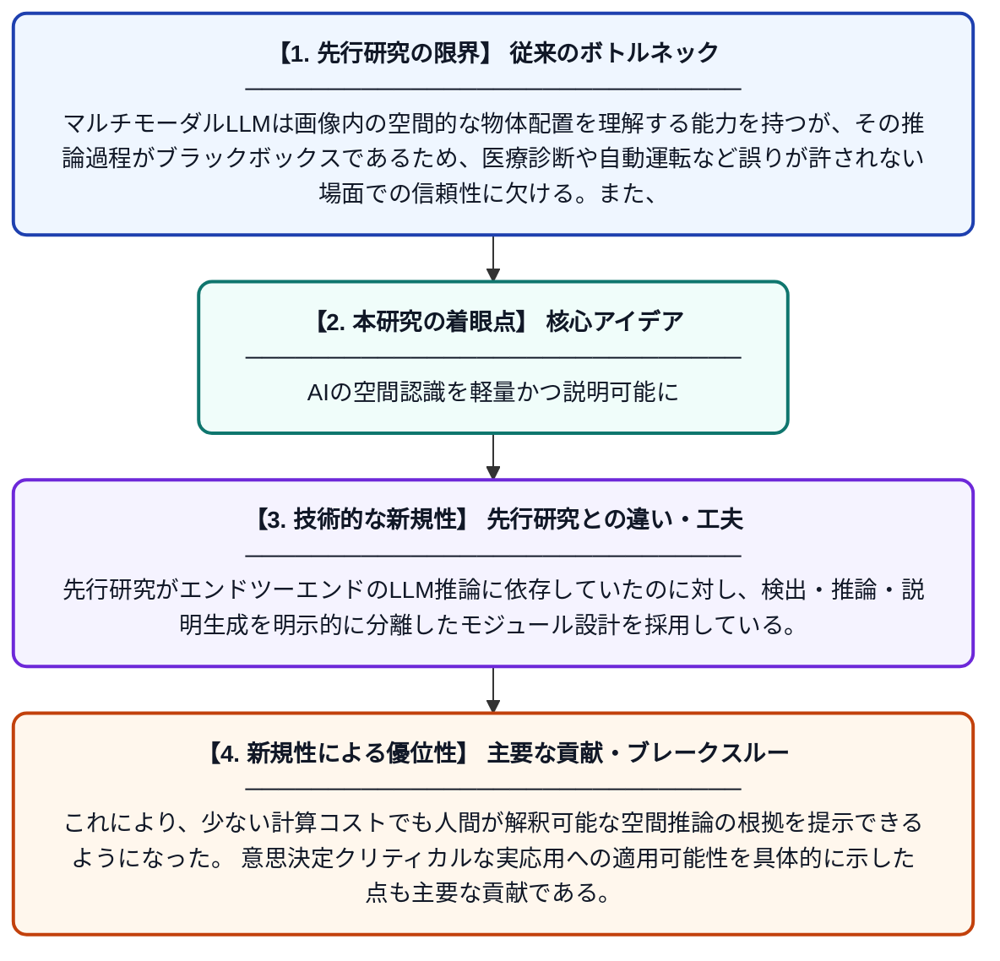

# 意思決定が重要なアプリケーションにおけるマルチモーダル大規模言語モデルの説明可能かつリソース効率的な空間推論

**Original Title**: *Explainable and Resource-Efficient Spatial Reasoning in Multimodal LLMs for Decision-Critical Applications*

> **💡 一言要約**: AIの空間認識を軽量かつ説明可能に

| 項目 | 内容 |
|---|---|
| **著者** | P Jain, K Dasgupta, R Roy, S Tripathi |
| **掲載誌** | arXiv preprint arXiv:2607.27145 2026 |
| **アラートキーワード** | Open-Vocabulary Object ... |
| **PDF** | [https://arxiv.org/pdf/2607.27145](https://arxiv.org/pdf/2607.27145) |
| **原文リンク** | [https://arxiv.org/pdf/2607.27145](https://arxiv.org/pdf/2607.27145) |
| **PDF版要約** | [README.pdf](./README.pdf) |

---

## 📊 新規性の図解（先行研究との違いと本研究のブレークスルー）

## 📝 要約

本論文は、マルチモーダル大規模言語モデル（LLM）が画像内の物体の位置関係や空間的な配置を推論する際の説明可能性とリソース効率を両立させる手法を提案する。YOLO-World-Lを活用したオープン語彙物体検出を基盤とし、医療や自動運転などの意思決定が重要な場面での信頼性向上を目指す。従来のブラックボックス的なアプローチとは異なり、推論過程を人間が理解できる形で示しながら計算コストを抑えることを実現している。

## ❓ どんな問題に取り組んだか

マルチモーダルLLMは画像内の空間的な物体配置を理解する能力を持つが、その推論過程がブラックボックスであるため、医療診断や自動運転など誤りが許されない場面での信頼性に欠ける。また、高精度な空間推論には膨大な計算リソースが必要であり、実用的なシステムへの組み込みが困難という課題もある。

## ✨ 何が新しい？何がすごい？（新規性）

本研究は、YOLO-World-Lによるオープン語彙物体検出と構造化された空間推論パイプラインを組み合わせることで、説明可能性とリソース効率を同時に達成する点が新しい。先行研究がエンドツーエンドのLLM推論に依存していたのに対し、検出・推論・説明生成を明示的に分離したモジュール設計を採用している。これにより、少ない計算コストでも人間が解釈可能な空間推論の根拠を提示できるようになった。意思決定クリティカルな実応用への適用可能性を具体的に示した点も主要な貢献である。

## 🎓 大学1年生向けの解説

AIは写真を見て「この物体はどこにある？」という空間的な質問に答えられますが、なぜその答えを出したのかを説明することが苦手です。この研究では、まず写真の中の物体を見つける技術（YOLO）と、大規模言語モデルを組み合わせることで、AIが「なぜそう判断したか」を人間にわかるように説明できる仕組みを作りました。さらに、重い計算をなるべく減らして、スマホや小型コンピュータでも動くような軽量化も実現しています。これにより、お医者さんのサポートや自動運転カーなど「間違いが許されない場面」でも安心して使えるAIを目指しています。
