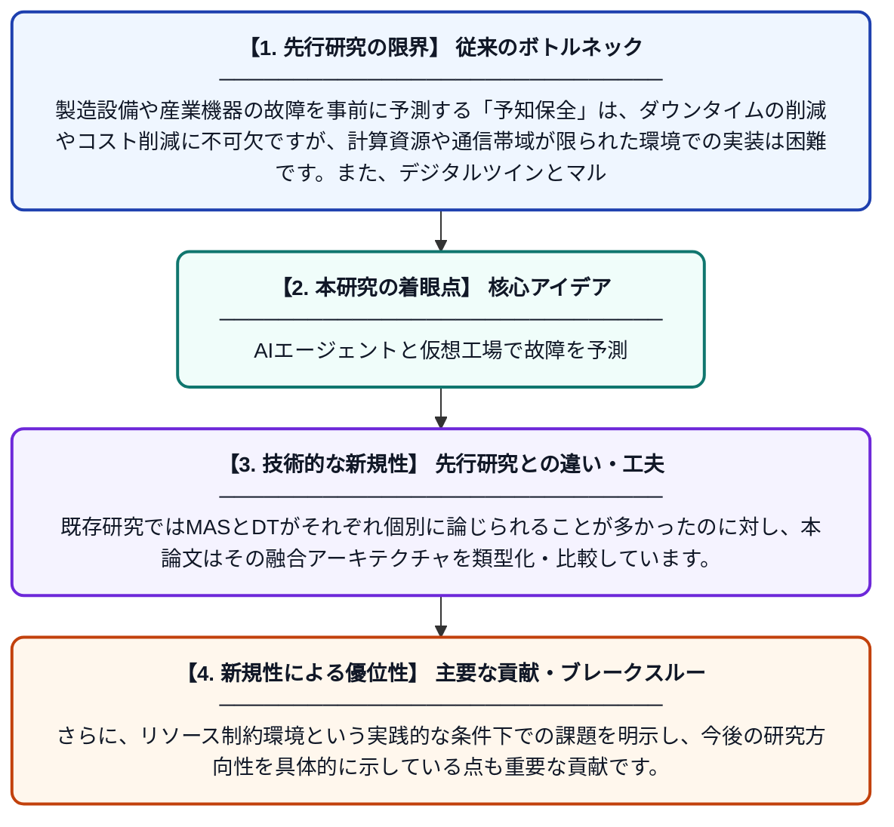

# 予知保全のためのマルチエージェントシステム駆動型デジタルツイン：アーキテクチャ、技術、および未解決研究課題

**Original Title**: *Multi-Agent System-driven Digital Twins for predictive maintenance: architectures, technologies and open research challenges*

> **💡 一言要約**: AIエージェントと仮想工場で故障を予測

| 項目 | 内容 |
|---|---|
| **著者** | KA Coulibaly, M Hamlich |
| **掲載誌** | arXiv preprint arXiv:2607.21873 2026 |
| **アラートキーワード** | multi agent |
| **PDF** | [https://arxiv.org/pdf/2607.21873](https://arxiv.org/pdf/2607.21873) |
| **原文リンク** | [https://arxiv.org/pdf/2607.21873](https://arxiv.org/pdf/2607.21873) |
| **PDF版要約** | [README.pdf](./README.pdf) |

---

## 📊 新規性の図解（先行研究との違いと本研究のブレークスルー）

## 📝 要約

本論文は、マルチエージェントシステム（MAS）とデジタルツイン（DT）の融合領域を体系的にレビューし、特にリソースが制約された環境における予知保全への応用に焦点を当てています。547本以上の論文を批判的に分析し、現状のアーキテクチャや技術的動向を整理しています。さらに、実用化に向けた未解決の研究課題を明確に提示しています。

## ❓ どんな問題に取り組んだか

製造設備や産業機器の故障を事前に予測する「予知保全」は、ダウンタイムの削減やコスト削減に不可欠ですが、計算資源や通信帯域が限られた環境での実装は困難です。また、デジタルツインとマルチエージェントシステムを組み合わせた研究は断片的であり、体系的な知見が不足していました。

## ✨ 何が新しい？何がすごい？（新規性）

547本以上の文献を網羅的に調査し、MASとデジタルツインを統合した予知保全システムに関する初の包括的なシステマティックレビューを提供している点が新しいです。既存研究ではMASとDTがそれぞれ個別に論じられることが多かったのに対し、本論文はその融合アーキテクチャを類型化・比較しています。さらに、リソース制約環境という実践的な条件下での課題を明示し、今後の研究方向性を具体的に示している点も重要な貢献です。

## 🎓 大学1年生向けの解説

「デジタルツイン」とは、現実の機械や設備をコンピュータ上に仮想的に再現したものです。「マルチエージェントシステム」とは、複数のAIプログラムが協力して問題を解決する仕組みです。この論文では、この2つを組み合わせることで、工場の機械が壊れる前に「そろそろ故障しそう」と予測できるシステムを研究しています。500本以上の先行研究を丁寧に調べて、どんな技術が使われているか、どんな問題がまだ残っているかをわかりやすくまとめた「教科書的なまとめ論文」です。
