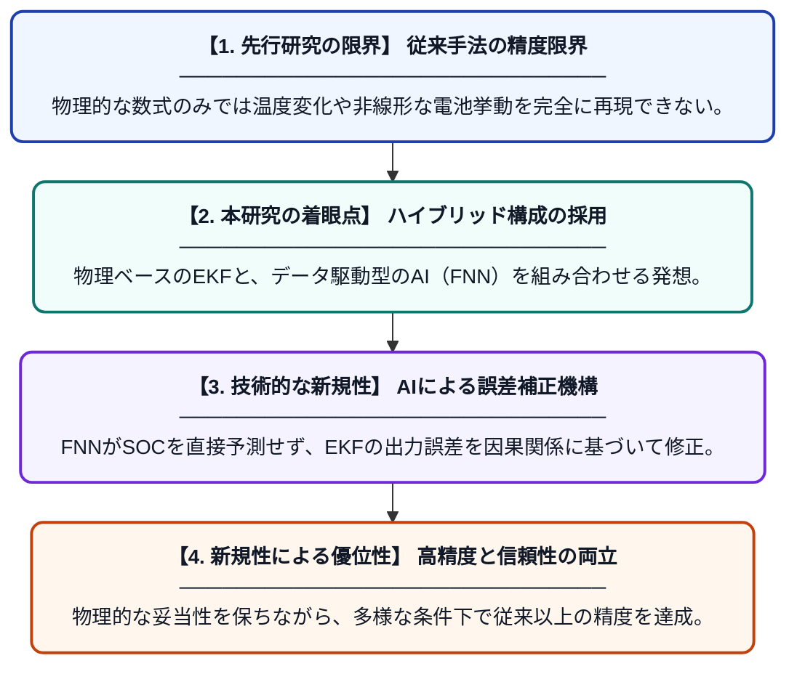

# リチウムイオン電池の残量推定における拡張カルマンフィルタと順伝播型ニューラルネットワークによるハイブリッド補正手法

**Original Title**: *Hybrid Extended Kalman Filtering and Feedforward Neural Correction for Lithium-Ion Battery State-of-Charge Estimation*

> **💡 一言要約**: 物理モデルとAIの融合で電池残量を高精度に推定

| 項目 | 内容 |
|---|---|
| **著者** | D Rastogi, M Goswami |
| **掲載誌** | 2026 |
| **アラートキーワード** | kalman filter |
| **PDF** | [https://assets-eu.researchsquare.com/files/rs-11634907/v1/06324726-81c5-44c5-b6e6-cca964b5a379.pdf?c=1794214498](https://assets-eu.researchsquare.com/files/rs-11634907/v1/06324726-81c5-44c5-b6e6-cca964b5a379.pdf?c=1794214498) |
| **原文リンク** | [https://www.researchsquare.com/article/rs-11634907/latest.pdf](https://www.researchsquare.com/article/rs-11634907/latest.pdf) |
| **PDF版要約** | [README.pdf](./README.pdf) |

---

## 📊 新規性の図解（先行研究との違いと本研究のブレークスルー）

## 📝 要約

温度依存型の等価回路モデルに基づく拡張カルマンフィルタ（EKF）と、順伝播型ニューラルネットワーク（FNN）を組み合わせたハイブリッド推定手法を提案しています。FNNはSOCを独立して予測するのではなく、EKFの推定過程に生じる誤差を補正するために因果関係データを活用し、精度の向上を図っています。

## ❓ どんな問題に取り組んだか

リチウムイオン電池の充電状態（SOC）の推定は、温度変化や化学的複雑さにより、従来の数学的モデルだけでは誤差が生じやすいという課題があります。また、純粋なAIモデルは物理的な根拠に欠け、予測の信頼性が不足するという問題がありました。

## ✨ 何が新しい？何がすごい？（新規性）

本研究の最大の特徴は、温度依存型の1次等価回路モデルを用いたEKFと、誤差を補正するFNNを融合させた点にあります。FNNはSOCをゼロから予測するのではなく、EKFが捉えきれない残差を修正する役割を担います。この「物理モデル主導＋AI補正」というアプローチにより、物理的な解釈性を維持したまま、劇的な推定精度の改善を達成しました。

## 🎓 大学1年生向けの解説

スマホのバッテリー残量表示をより正確にするための研究です。従来は数学的な計算式（EKF）で残量を予測していましたが、気温などの影響でズレが生じることがありました。そこで、AIに「計算式の苦手な部分だけ」をサポートさせる新しい仕組みを作りました。ベテランの職人（数学モデル）と、変化に強い若手（AI）が協力することで、どんな環境でも正確な残量がわかるようになります。
