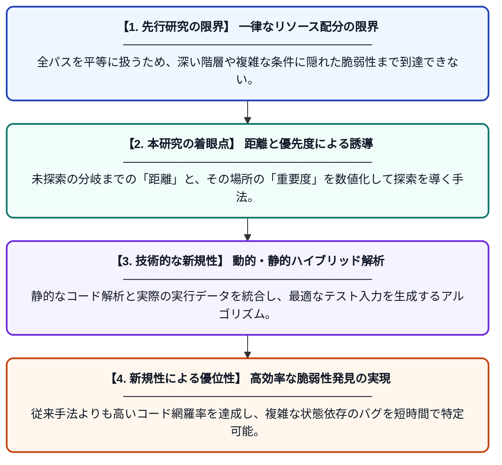

# DPFuzz: スマートコントラクトのための動的・静的分岐距離と分岐優先度を用いたファジング

**Original Title**: *DPFuzz: Dynamic-Static Branch Distance and Branch Priority-Driven Fuzzing for Smart Contract*

> **💡 一言要約**: 分岐距離と優先度で重要パスを狙い撃つ高精度バグ調査

| 項目 | 内容 |
|---|---|
| **著者** | Y Yao, E Xu, Y Zhang, Y Gao, Y Sun |
| **掲載誌** | … on Dependable and Secure Computing 2026 |
| **アラートキーワード** | Secure Computing |
| **原文リンク** | [https://www.computer.org/csdl/journal/tq/5555/01/11782851/2liF7yxLYis](https://www.computer.org/csdl/journal/tq/5555/01/11782851/2liF7yxLYis) |
| **PDF版要約** | [README.pdf](./README.pdf) |

---

## 📊 新規性の図解（先行研究との違いと本研究のブレークスルー）

## 📝 要約

複雑な状態依存パスを持つスマートコントラクトの脆弱性を効率的に発見するためのファジングフレームワーク「DPFuzz」を提案する論文です。静的・動的解析を組み合わせた分岐距離の算出と、分岐の希少性に基づく優先度付きリソース配分により、深い階層にある脆弱性の特定率を向上させています。

## ❓ どんな問題に取り組んだか

スマートコントラクトは内部状態に依存する複雑な実行パスを持ちますが、既存のファジングツールは全パスに一律にリソースを配分するため、探索が非効率でした。その結果、深い階層にある重大な脆弱性を見逃したり、冗長な入力を大量に生成したりするという課題がありました。

## ✨ 何が新しい？何がすごい？（新規性）

本研究の新規性は、静的なコード構造と動的な実行情報の両方から「分岐距離」を算出し、未踏のコード領域への到達を数学的に最適化した点にあります。さらに、実行パスの希少性や重要度に応じた「分岐優先度」を動的に管理する仕組みを導入し、有望なテストケースへ優先的にリソースを割り振る機能を備えています。これにより、従来のツールでは到達困難だった複雑なロジック内のバグを高速かつ高精度に検出することが可能になりました。

## 🎓 大学1年生向けの解説

スマートコントラクトは、一度公開すると修正が極めて難しい「お金を扱うプログラム」です。しかし、プログラムの中には複雑な迷路のような部分があり、これまでの自動チェックツールではその奥深くまで調べることができませんでした。この研究では、迷路のゴールまでの距離を予測し、重要そうな道に絞って集中的に探検させることで、隠れた重大なミスを素早く見つける新しい「探検ルール」を作り出しました。これにより、ハッカーに悪用される前に安全性を確認できるようになります。
