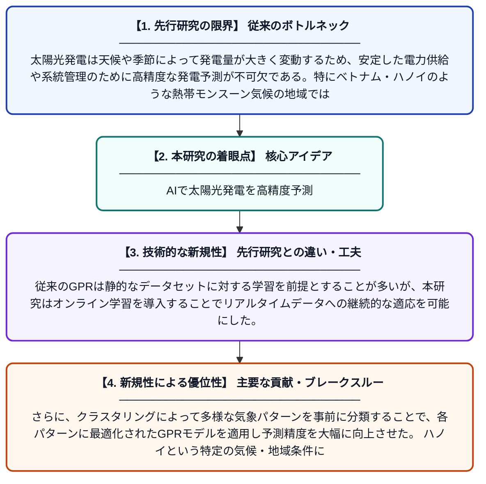

# ハイブリッドクラスタリングとオンラインガウス過程回帰モデルによるベトナム・ハノイの太陽光発電予測

**Original Title**: *A hybrid clustering and online gaussian process regression model for solar power forecasting in Hanoi, Vietnam*

> **💡 一言要約**: AIで太陽光発電を高精度予測

| 項目 | 内容 |
|---|---|
| **著者** | AT Phan, N Eva, AH Nguyen, TTH VU, HTT Le, VC Bui |
| **掲載誌** | Next Energy 2026 |
| **アラートキーワード** | gaussian process |
| **原文リンク** | [https://www.sciencedirect.com/science/article/pii/S2949821X2600325X](https://www.sciencedirect.com/science/article/pii/S2949821X2600325X) |
| **PDF版要約** | [README.pdf](./README.pdf) |

---

## 📊 新規性の図解（先行研究との違いと本研究のブレークスルー）

## 📝 要約

本研究は、ベトナムのハノイにおける太陽光発電量を高精度に予測するため、クラスタリング手法とオンラインガウス過程回帰（GPR）を組み合わせたハイブリッドモデルを提案している。クラスタリングによってデータを気象パターンごとにグループ化し、各グループに対してベイズ非パラメトリック手法であるGPRを適用することで予測精度を向上させる。リアルタイムデータへの適応が可能なオンライン学習の仕組みを取り入れており、実用的な太陽光発電管理への応用が期待される。

## ❓ どんな問題に取り組んだか

太陽光発電は天候や季節によって発電量が大きく変動するため、安定した電力供給や系統管理のために高精度な発電予測が不可欠である。特にベトナム・ハノイのような熱帯モンスーン気候の地域では、気象パターンが複雑で既存の予測モデルでは精度が不十分なケースがある。また、時々刻々と変化するデータにリアルタイムで対応できる柔軟なモデルの開発が求められていた。

## ✨ 何が新しい？何がすごい？（新規性）

本研究の新規性は、クラスタリングとオンラインGPRを組み合わせたハイブリッドアーキテクチャにある。従来のGPRは静的なデータセットに対する学習を前提とすることが多いが、本研究はオンライン学習を導入することでリアルタイムデータへの継続的な適応を可能にした。さらに、クラスタリングによって多様な気象パターンを事前に分類することで、各パターンに最適化されたGPRモデルを適用し予測精度を大幅に向上させた。ハノイという特定の気候・地域条件に特化したモデル構築も、実用面での重要な貢献である。

## 🎓 大学1年生向けの解説

太陽光パネルは天気によって発電する量が毎日変わるため、「明日どのくらい発電できるか」を事前に正確に知ることがとても大切です。この研究では、過去の気象データをいくつかのグループに分類し（クラスタリング）、それぞれのグループに対して「ガウス過程回帰」という統計的な予測手法を使うことで、発電量を高い精度で予測できるシステムを作りました。さらに、新しいデータが入ってくるたびに自動的に学習し直す「オンライン学習」の仕組みも組み込んでいます。これにより、季節や気候が変わっても常に高精度な予測ができるようになります。ベトナムのハノイという実際の都市のデータを使って検証しており、再生可能エネルギーの普及に役立てることを目指しています。
