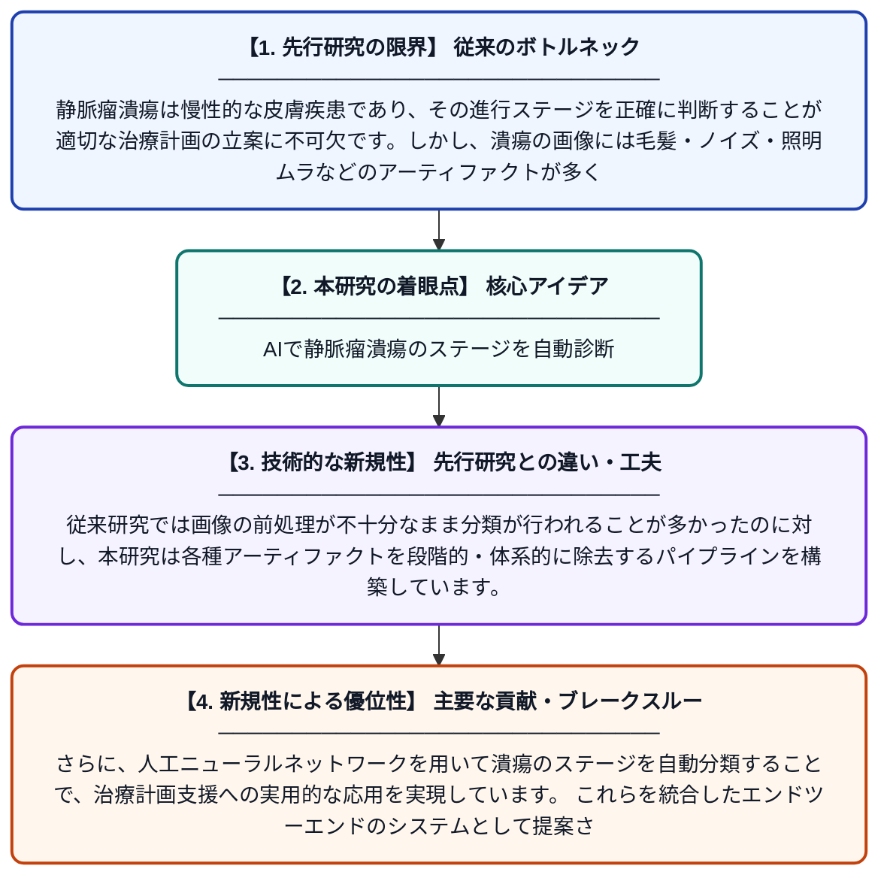

# ANN Net: 治療計画のための人工ニューラルネットワークを用いた静脈瘤潰瘍のステージ予測

**Original Title**: *ANN Net: PREDICTION OF STAGES IN VARICOSE ULCER USING ARTIFICIAL NEURAL NETWORK FOR TREATMENT PLANNING*

> **💡 一言要約**: AIで静脈瘤潰瘍のステージを自動診断

| 項目 | 内容 |
|---|---|
| **著者** | V Rajathi, AS Ismail, AK RS, TS Kumar |
| **掲載誌** | Systems and Soft Computing 2026 |
| **アラートキーワード** | MRFs Markov |
| **原文リンク** | [https://www.sciencedirect.com/science/article/pii/S2772941926001353](https://www.sciencedirect.com/science/article/pii/S2772941926001353) |
| **PDF版要約** | [README.pdf](./README.pdf) |

---

## 📊 新規性の図解（先行研究との違いと本研究のブレークスルー）

## 📝 要約

本研究では、静脈瘤潰瘍の画像から病変のステージを自動的に分類するための人工ニューラルネットワーク（ANN）ベースのシステムを提案しています。前処理段階では、フラッシュライトアーティファクトの除去にマルコフ確率場（MRF）とダークチャンネル事前分布（DCP）アルゴリズムを、毛髪除去にMSFLBP技術を、ノイズ除去にパッチベース手法をそれぞれ適用しています。これにより、医師が適切な治療計画を立てられるよう、潰瘍の進行ステージを高精度に予測することを目指しています。

## ❓ どんな問題に取り組んだか

静脈瘤潰瘍は慢性的な皮膚疾患であり、その進行ステージを正確に判断することが適切な治療計画の立案に不可欠です。しかし、潰瘍の画像には毛髪・ノイズ・照明ムラなどのアーティファクトが多く含まれており、自動的かつ正確なステージ分類が困難でした。熟練した医師による目視診断には時間とコストがかかり、客観性にも課題がありました。

## ✨ 何が新しい？何がすごい？（新規性）

本研究の新規性は、複数の高度な前処理技術（MRF、DCP、MSFLBP、パッチベースノイズ除去）を組み合わせ、静脈瘤潰瘍画像の品質を大幅に向上させた点にあります。従来研究では画像の前処理が不十分なまま分類が行われることが多かったのに対し、本研究は各種アーティファクトを段階的・体系的に除去するパイプラインを構築しています。さらに、人工ニューラルネットワークを用いて潰瘍のステージを自動分類することで、治療計画支援への実用的な応用を実現しています。これらを統合したエンドツーエンドのシステムとして提案されている点が主要な貢献です。

## 🎓 大学1年生向けの解説

静脈瘤潰瘍とは、足などにできる慢性的な傷のことで、適切な治療のためにはその重症度（ステージ）を正しく知ることが大切です。この研究では、傷の写真をコンピュータに読み込ませ、AIが自動でステージを判定するシステムを作りました。写真には毛髪や光の反射などのノイズが混じっているため、まずそれらをきれいに取り除く技術を複数組み合わせています。その後、人間の脳の神経回路を模した「人工ニューラルネットワーク」に画像を学習させることで、高い精度でステージを予測できるようになりました。このシステムが実用化されれば、医師の診断をサポートし、より早く正確な治療につなげることができます。
