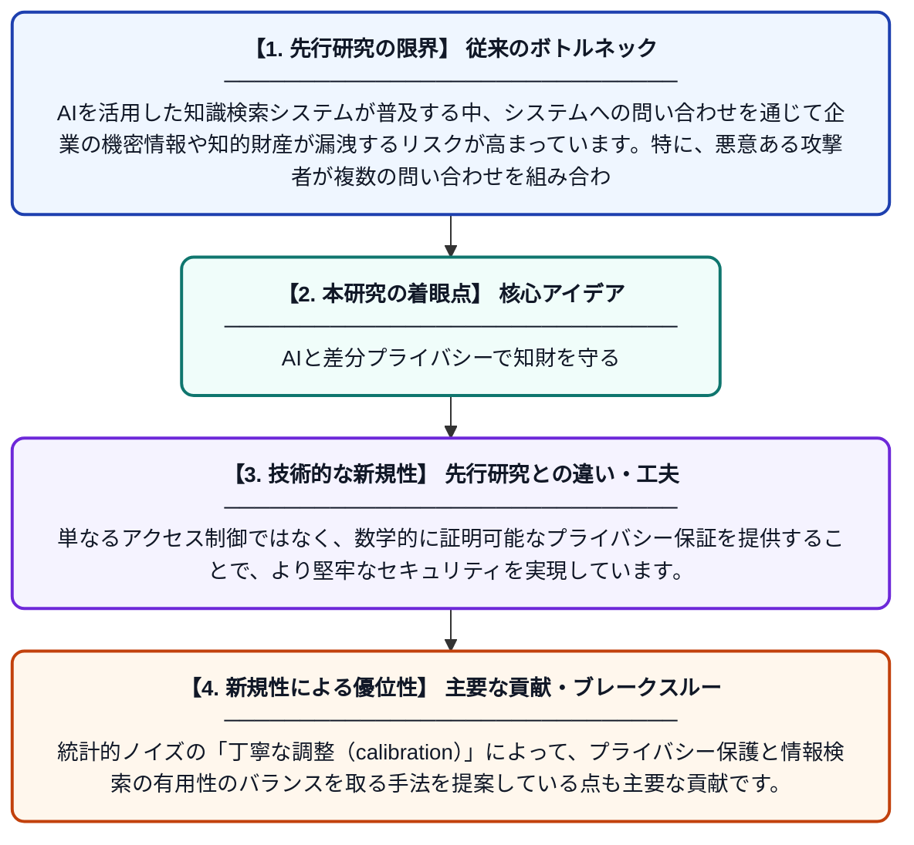

# 検索拡張型知的財産知識システムにおける差分プライバシー技術

**Original Title**: *Differential Privacy Techniques for Retrieval-Augmented Intellectual Property Knowledge Systems*

> **💡 一言要約**: AIと差分プライバシーで知財を守る

| 項目 | 内容 |
|---|---|
| **著者** | B Turner |
| **掲載誌** | 2026 |
| **アラートキーワード** | differential privacy |
| **PDF** | [https://www.researchgate.net/profile/Julianah-Laura/publication/410669050_Differential_Privacy_Techniques_for_Retrieval-Augmented_Intellectual_Property_Knowledge_Systems/links/6a600c8aa066b6236f2b253e/Differential-Privacy-Techniques-for-Retrieval-Augmented-Intellectual-Property-Knowledge-Systems.pdf](https://www.researchgate.net/profile/Julianah-Laura/publication/410669050_Differential_Privacy_Techniques_for_Retrieval-Augmented_Intellectual_Property_Knowledge_Systems/links/6a600c8aa066b6236f2b253e/Differential-Privacy-Techniques-for-Retrieval-Augmented-Intellectual-Property-Knowledge-Systems.pdf) |
| **原文リンク** | [https://www.researchgate.net/profile/Julianah-Laura/publication/410669050_Differential_Privacy_Techniques_for_Retrieval-Augmented_Intellectual_Property_Knowledge_Systems/links/6a600c8aa066b6236f2b253e/Differential-Privacy-Techniques-for-Retrieval-Augmented-Intellectual-Property-Knowledge-Systems.pdf](https://www.researchgate.net/profile/Julianah-Laura/publication/410669050_Differential_Privacy_Techniques_for_Retrieval-Augmented_Intellectual_Property_Knowledge_Systems/links/6a600c8aa066b6236f2b253e/Differential-Privacy-Techniques-for-Retrieval-Augmented-Intellectual-Property-Knowledge-Systems.pdf) |
| **PDF版要約** | [README.pdf](./README.pdf) |

---

## 📊 新規性の図解（先行研究との違いと本研究のブレークスルー）

## 📝 要約

本論文は、検索拡張生成（RAG）システムに差分プライバシーを適用することで、知的財産に関する機密情報を保護する手法を提案しています。計算処理に統計的ノイズを注入することで、敵対的な推論攻撃から情報を守ることができます。数学的な証明に基づくプライバシー保証により、高度な攻撃手法にも耐性を持つシステムを実現しています。

## ❓ どんな問題に取り組んだか

AIを活用した知識検索システムが普及する中、システムへの問い合わせを通じて企業の機密情報や知的財産が漏洩するリスクが高まっています。特に、悪意ある攻撃者が複数の問い合わせを組み合わせることで、保護されているはずの情報を間接的に推測できてしまう「推論攻撃」が深刻な脅威となっています。

## ✨ 何が新しい？何がすごい？（新規性）

本研究は、RAG（Retrieval-Augmented Generation）という最新のAI検索技術に差分プライバシーを組み合わせた点が新しく、知的財産という具体的なユースケースに特化している点が先行研究と異なります。単なるアクセス制御ではなく、数学的に証明可能なプライバシー保証を提供することで、より堅牢なセキュリティを実現しています。統計的ノイズの「丁寧な調整（calibration）」によって、プライバシー保護と情報検索の有用性のバランスを取る手法を提案している点も主要な貢献です。

## 🎓 大学1年生向けの解説

企業の特許や技術情報などの「知的財産」をAIシステムで検索できるようにすると、便利な反面、情報が盗まれるリスクがあります。この論文では「差分プライバシー」という技術を使い、計算結果にわざとランダムなノイズ（ぼかし）を加えることで、攻撃者が情報を推測できないようにします。例えば、何度も質問を繰り返すことで秘密を推測しようとしても、毎回少しずつ違う結果が返るため、正確な情報を盗み取ることができなくなります。この方法は数学的に「絶対にこれ以上は漏れない」と証明できるため、非常に信頼性が高いセキュリティ技術です。
