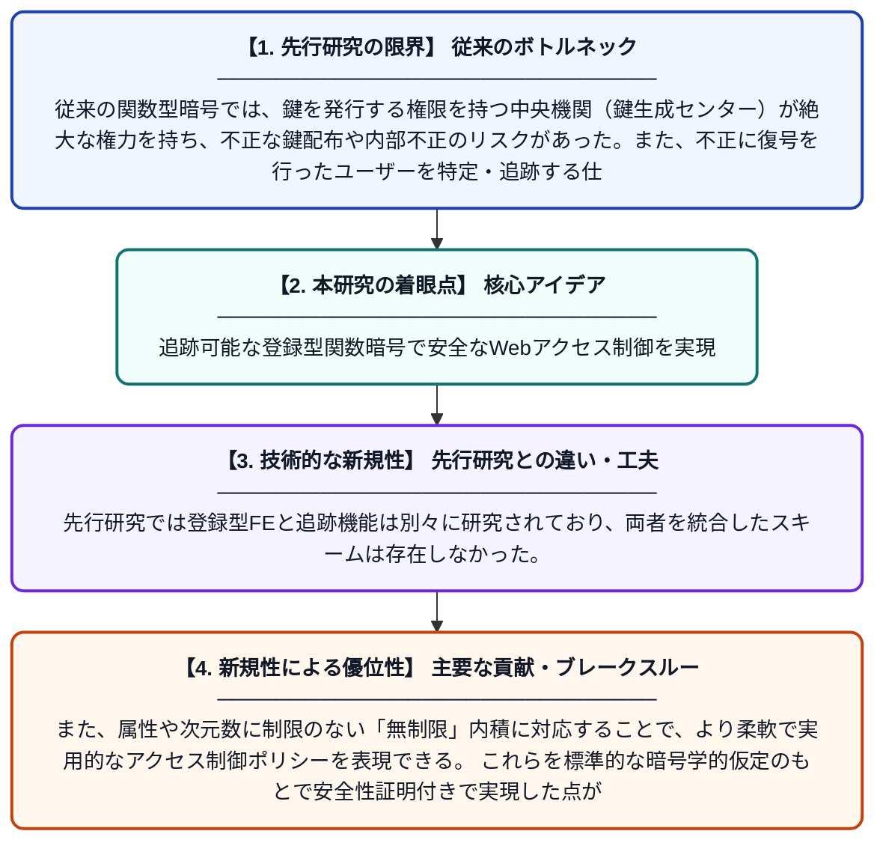

# Webサービスプラットフォームにおける無制限内積に対する追跡可能な登録型関数型暗号

**Original Title**: *Traceable Registered Functional Encryption for Unbounded Inner Product in Web Service Platforms*

> **💡 一言要約**: 追跡可能な登録型関数暗号で安全なWebアクセス制御を実現

| 項目 | 内容 |
|---|---|
| **著者** | J Tian, J Ning, J Shen, K Zhang, W You, L Zhang |
| **掲載誌** | IEEE Transactions on Dependable and Secure Computing 2026 |
| **アラートキーワード** | Secure Computing |
| **原文リンク** | [https://ieeexplore.ieee.org/abstract/document/11619558/](https://ieeexplore.ieee.org/abstract/document/11619558/) |
| **PDF版要約** | [README.pdf](./README.pdf) |

---

## 📊 新規性の図解（先行研究との違いと本研究のブレークスルー）

## 📝 要約

本論文は、Webサービスにおけるアクセス制御のセキュリティとコンプライアンスを強化するため、追跡可能な登録型関数型暗号方式を提案する。具体的には、無制限の内積計算に対応した新しい暗号スキームを設計し、不正なユーザーの追跡機能と鍵の登録管理機能を両立させている。これにより、信頼できる第三者機関への過度な依存を排除しながら、安全で説明責任のあるデータ共有を実現する。

## ❓ どんな問題に取り組んだか

従来の関数型暗号では、鍵を発行する権限を持つ中央機関（鍵生成センター）が絶大な権力を持ち、不正な鍵配布や内部不正のリスクがあった。また、不正に復号を行ったユーザーを特定・追跡する仕組みが不十分であり、Webサービスにおけるアクセス制御の信頼性や法令遵守に課題があった。さらに、既存の登録型暗号方式は計算できる関数の複雑さに制限があり、実用的な内積計算には対応しきれていなかった。

## ✨ 何が新しい？何がすごい？（新規性）

本研究は、登録型関数型暗号（Registered FE）に追跡可能性（Traceability）を初めて組み合わせ、中央権限への信頼依存を削減しながら不正ユーザーの特定も可能にした点が新しい。先行研究では登録型FEと追跡機能は別々に研究されており、両者を統合したスキームは存在しなかった。また、属性や次元数に制限のない「無制限」内積に対応することで、より柔軟で実用的なアクセス制御ポリシーを表現できる。これらを標準的な暗号学的仮定のもとで安全性証明付きで実現した点が主要な貢献である。

## 🎓 大学1年生向けの解説

インターネット上のサービスでは、「誰がどのデータにアクセスできるか」をルールとして設定する必要があります。この論文は、そのルールを暗号の力で守りながら、もし誰かが不正にデータを覗き見しようとしたら、その人物を特定できる仕組みを作りました。さらに、鍵を管理する偉い管理者が悪いことをできないように、管理者の権力を分散させる工夫もしています。「内積」というデータ同士の類似度を計算する処理を暗号のまま行えるため、AIや検索サービスなどへの応用も期待されます。
