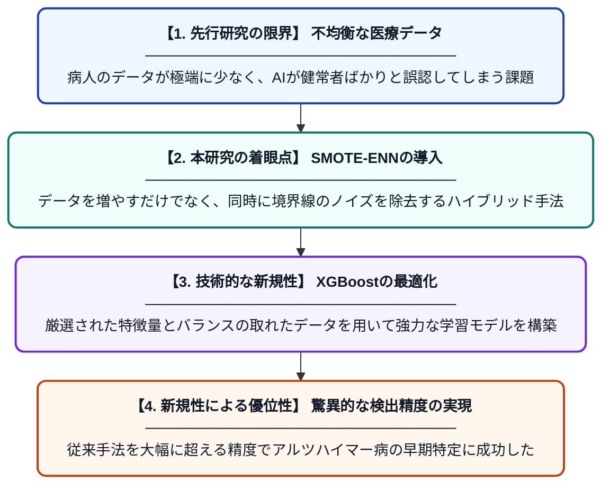

# データ不均衡の是正と特徴量選択を用いたアルツハイマー病検出のための堅牢な機械学習パイプライン

**Original Title**: *A Robust Machine Learning Pipeline for Alzheimer's Disease Detection Using Data Balancing and Feature Selection*

> **💡 一言要約**: 不均衡を克服し、認知症をAIで高精度に検出

| 項目 | 内容 |
|---|---|
| **著者** | A METTAHRI, S EL KHAMLICHI, EL M'barek, B ETTAKI |
| **掲載誌** | Statistics, Optimization & … 2026 |
| **アラートキーワード** | SMOTE |
| **原文リンク** | [https://iapress.org/index.php/soic/article/view/4377](https://iapress.org/index.php/soic/article/view/4377) |
| **PDF版要約** | [README.pdf](./README.pdf) |

---

## 📊 新規性の図解（先行研究との違いと本研究のブレークスルー）

## 📝 要約

この研究は、アルツハイマー病の早期検出精度を高めるため、不均衡なデータの調整と最適な特徴量の選択を組み合わせた新しい手法を提案しています。SMOTE-ENNによるデータ補正とXGBoostアルゴリズムを組み合わせることで、従来のモデルを凌駕する高い検出性能を達成しました。

## ❓ どんな問題に取り組んだか

医療データでは、疾患を持つ患者のデータが健常者に比べて極端に少ない「データ不均衡」が頻繁に発生し、これがAIの予測精度を低下させる要因となります。また、診断に不要なデータ項目が混じっていると、モデルの学習が効率的に行われないという課題がありました。

## ✨ 何が新しい？何がすごい？（新規性）

本研究は、データの水増し手法であるSMOTEと、ノイズ除去を行うENNを組み合わせた「SMOTE-ENN」を採用し、データ分布の歪みを効果的に解消した点が画期的です。さらに、特徴量選択パイプラインを最適化し、XGBoostと組み合わせることで、従来の単純なオーバーサンプリング手法よりも頑健で高精度な予測を実現しました。これにより、初期段階のアルツハイマー病患者をより正確に特定することが可能になりました。

## 🎓 大学1年生向けの解説

アルツハイマー病を早期に見つけるにはAIが役立ちますが、病気の人のデータは数が少ないため、AIがうまく学習できないという問題がありました。この研究では、足りないデータを賢く増やし、同時に診断に邪魔な情報を削ぎ落とすことで、AIが正確に判断できるようにしました。この新しい方法を使うと、これまでのAIよりもはるかに高い精度で病気を見分けることができます。将来的には、病院での診断を助ける強力なツールになることが期待されています。
