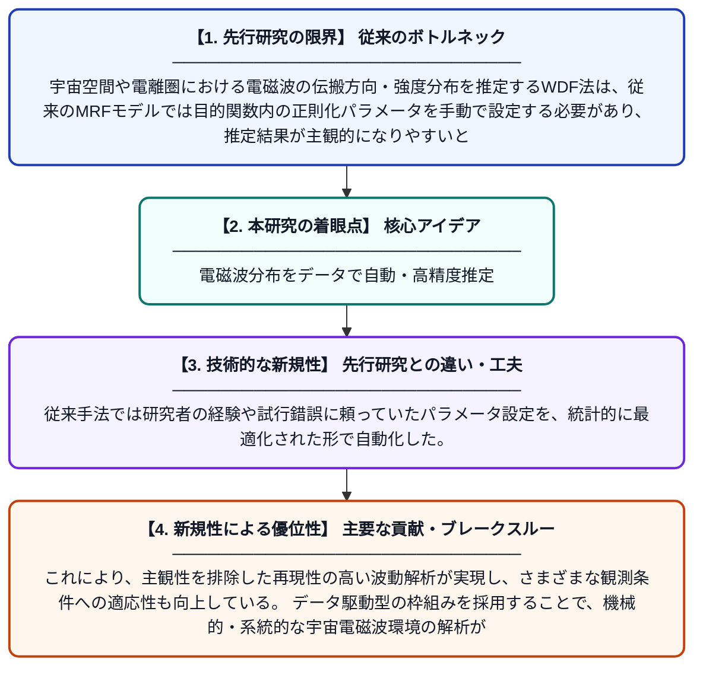

# 汎化誤差最小化に基づくデータ駆動型波分布関数推定法

**Original Title**: *Data‐driven wave distribution function method based on generalization error minimization*

> **💡 一言要約**: 電磁波分布をデータで自動・高精度推定

| 項目 | 内容 |
|---|---|
| **著者** | H Katsuda, M Ota, Y Kasahara |
| **掲載誌** | Radio Science 2026 |
| **アラートキーワード** | Markov random"  fields |
| **原文リンク** | [https://agupubs.onlinelibrary.wiley.com/doi/abs/10.1029/2025RS008562](https://agupubs.onlinelibrary.wiley.com/doi/abs/10.1029/2025RS008562) |
| **PDF版要約** | [README.pdf](./README.pdf) |

---

## 📊 新規性の図解（先行研究との違いと本研究のブレークスルー）

## 📝 要約

本研究は、電磁波の伝搬方向や強度の分布を推定する「波分布関数（WDF）法」を改良した新しいアルゴリズムを提案する。従来のマルコフ確率場（MRF）モデルに基づくWDF法の目的関数を、汎化誤差の最小化という観点から再設計することで、より精度の高い推定を実現する。データ駆動型のアプローチにより、人為的なパラメータ設定への依存を減らし、観測データに即した客観的な波動環境の解析が可能となる。

## ❓ どんな問題に取り組んだか

宇宙空間や電離圏における電磁波の伝搬方向・強度分布を推定するWDF法は、従来のMRFモデルでは目的関数内の正則化パラメータを手動で設定する必要があり、推定結果が主観的になりやすいという問題があった。適切なパラメータ選択が困難なため、観測データを最大限に活かした客観的な波動解析が難しかった。

## ✨ 何が新しい？何がすごい？（新規性）

本研究は、汎化誤差最小化の概念を導入することで、正則化パラメータをデータから自動的に決定できる新しいWDF推定アルゴリズムを構築した点が新規性である。従来手法では研究者の経験や試行錯誤に頼っていたパラメータ設定を、統計的に最適化された形で自動化した。これにより、主観性を排除した再現性の高い波動解析が実現し、さまざまな観測条件への適応性も向上している。データ駆動型の枠組みを採用することで、機械的・系統的な宇宙電磁波環境の解析が可能となった。

## 🎓 大学1年生向けの解説

宇宙空間には、さまざまな方向から飛んでくる電磁波が存在しており、その「どの方向からどれくらいの強さで来ているか」を調べる方法が波分布関数（WDF）法です。これまでの方法では、計算の際に人間が手動で調整しなければならない設定値があり、結果が人によって変わってしまう問題がありました。この研究では、コンピュータが観測データそのものから自動的に最適な設定を学ぶ仕組みを作り上げました。これにより、誰がやっても同じ客観的な結果が得られるようになりました。まるで料理のレシピを人の勘ではなく科学的な計測で決めるようなイメージです。
