# 視線推定における中央集権的ボトルネックを打破するための、もつれを解いた表現とスプリット連合学習の相乗効果

**Original Title**: *Synergizing Disentangled Representation and Split Federated Learning to Break Centralized Bottlenecks in Gaze Estimation*

> **💡 一言要約**: プライバシーを守り視線推定の限界を超える新手法

| 項目 | 内容 |
|---|---|
| **著者** | Y Wang, Z Luo, K Zhang, Z Sun, Z He, D Tao, T Tan |
| **掲載誌** | International Journal of … 2026 |
| **アラートキーワード** | Federated Learning |
| **原文リンク** | [https://link.springer.com/article/10.1007/s11263-026-03084-8](https://link.springer.com/article/10.1007/s11263-026-03084-8) |
| **PDF版要約** | [README.pdf](./README.pdf) |

---

## 📊 新規性の図解（先行研究との違いと本研究のブレークスルー）

```mermaid
%%{init: {'flowchart': {'wrappingWidth': 520, 'nodeSpacing': 18, 'rankSpacing': 28, 'padding': 14, 'curve': 'basis'}, 'themeVariables': {'fontSize': '14px'}}}%%
flowchart TD
    S1["<b>【1. 先行研究の限界】 従来のボトルネック</b><br/>──────────────────────────────<br/>従来の視線推定モデルは大量の顔画像を1箇所に集めて学習する必要があり、プライバシーの懸念やサーバーへの膨大な負荷が課題でした。また、ユーザーごとの端末性能や顔立ちの違いといったデー"]
    S2["<b>【2. 本研究の着眼点】 核心アイデア</b><br/>──────────────────────────────<br/>プライバシーを守り視線推定の限界を超える新手法"]
    S3["<b>【3. 技術的な新規性】 先行研究との違い・工夫</b><br/>──────────────────────────────<br/>個人固有の特徴（アイデンティティ）と視線情報を分離して抽出する仕組みを導入することで、各デバイスの特性に左右されない汎用的な学習を可能にしました。"]
    S4["<b>【4. 新規性による優位性】 主要な貢献・ブレークスルー</b><br/>──────────────────────────────<br/>これにより、中央サーバーにデータを集めることなく、従来の手法を凌駕する推定精度とプライバシー保護を両立させています。"]
    S1 --> S2
    S2 --> S3
    S3 --> S4
    style S1 fill:#EFF6FF,stroke:#1E40AF,stroke-width:2px,color:#111827,rx:8,ry:8
    style S2 fill:#F0FDFA,stroke:#0F766E,stroke-width:2px,color:#111827,rx:8,ry:8
    style S3 fill:#F5F3FF,stroke:#6D28D9,stroke-width:2px,color:#111827,rx:8,ry:8
    style S4 fill:#FFF7ED,stroke:#C2410C,stroke-width:2px,color:#111827,rx:8,ry:8
```

## 📝 要約

本研究は、視線推定においてプライバシーや計算負荷の課題となるデータの一極集中を避けるため、SplitFedGazeという分散型フレームワークを提案しています。データの「もつれを解いた表現学習」と「スプリット連合学習」を組み合わせることで、生データを共有せずに高精度な視線推定を実現しました。

## ❓ どんな問題に取り組んだか

従来の視線推定モデルは大量の顔画像を1箇所に集めて学習する必要があり、プライバシーの懸念やサーバーへの膨大な負荷が課題でした。また、ユーザーごとの端末性能や顔立ちの違いといったデータの偏りが、学習の効率と精度を低下させていました。

## ✨ 何が新しい？何がすごい？（新規性）

本研究の核心は、「スプリット連合学習（SFL）」と「もつれを解いた表現学習」を初めて統合した点にあります。個人固有の特徴（アイデンティティ）と視線情報を分離して抽出する仕組みを導入することで、各デバイスの特性に左右されない汎用的な学習を可能にしました。これにより、中央サーバーにデータを集めることなく、従来の手法を凌駕する推定精度とプライバシー保護を両立させています。

## 🎓 大学1年生向けの解説

スマホなどで「どこを見ているか」を当てる技術は便利ですが、自分の顔写真をネットに送るのは不安ですよね。この研究では、写真を送らずに手元の端末だけでAIを賢くする新しい仕組みを作りました。さらに、顔の特徴と目線の情報をバラバラに分けて扱う工夫をすることで、どんな顔の人でも正確に目線を当てられるようになっています。みんなのプライバシーを守りながら、協力して高性能なAIを作る技術です。
