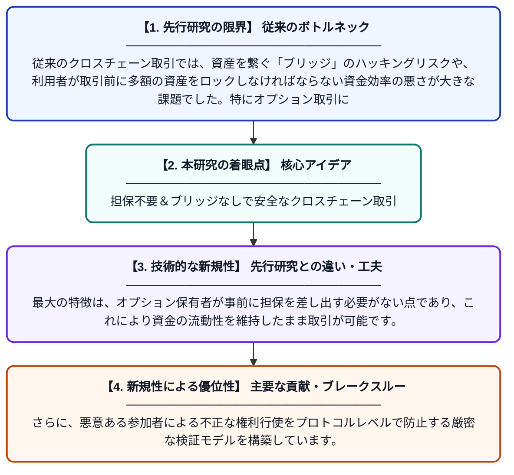

# 保有者の事前担保を不要とするブリッジレス・クロスチェーン・オプションの保護された権利行使

**Original Title**: *Protected Exercise for Bridgeless Cross-Chain Options Without Upfront Holder Collateral*

> **💡 一言要約**: 担保不要＆ブリッジなしで安全なクロスチェーン取引

| 項目 | 内容 |
|---|---|
| **著者** | Z Peng, J Liu, H Jia, J Yang, Y Xue, X Wang |
| **掲載誌** | … on Dependable and Secure Computing 2026 |
| **アラートキーワード** | Secure Computing |
| **原文リンク** | [https://ieeexplore.ieee.org/abstract/document/11749584/](https://ieeexplore.ieee.org/abstract/document/11749584/) |
| **PDF版要約** | [README.pdf](./README.pdf) |

---

## 📊 新規性の図解（先行研究との違いと本研究のブレークスルー）

## 📝 要約

異なるブロックチェーン間での資産取引において、リスクの高いブリッジを使用せず、かつ利用者が事前に担保を預ける必要もない新しいオプション取引プロトコルを提案しています。権利行使プロセスを数学的に保護することで、資金効率を最大化しながら安全な資産交換を実現しています。

## ❓ どんな問題に取り組んだか

従来のクロスチェーン取引では、資産を繋ぐ「ブリッジ」のハッキングリスクや、利用者が取引前に多額の資産をロックしなければならない資金効率の悪さが大きな課題でした。特にオプション取引においては、権利行使時の不確実性と信頼の欠如が普及を妨げていました。

## ✨ 何が新しい？何がすごい？（新規性）

本研究は、ブリッジを完全に排除しつつ、ハッシュタイムロック（HTLC）等の技術を高度化させた「保護された権利行使」メカニズムを導入しました。最大の特徴は、オプション保有者が事前に担保を差し出す必要がない点であり、これにより資金の流動性を維持したまま取引が可能です。さらに、悪意ある参加者による不正な権利行使をプロトコルレベルで防止する厳密な検証モデルを構築しています。

## 🎓 大学1年生向けの解説

異なる種類の仮想通貨（例えばビットコインとイーサリアム）を交換する際、これまでは「危ない橋」のような中継地点を使ったり、事前にお金を預けたりする必要がありました。この論文は、その橋を使わずに、しかも事前にお金を預けなくても、安全に交換の権利を使える魔法のような仕組みを提案しています。これにより、自分のお金をずっと手元に置いたまま、必要な時だけ安全に取引ができるようになります。
