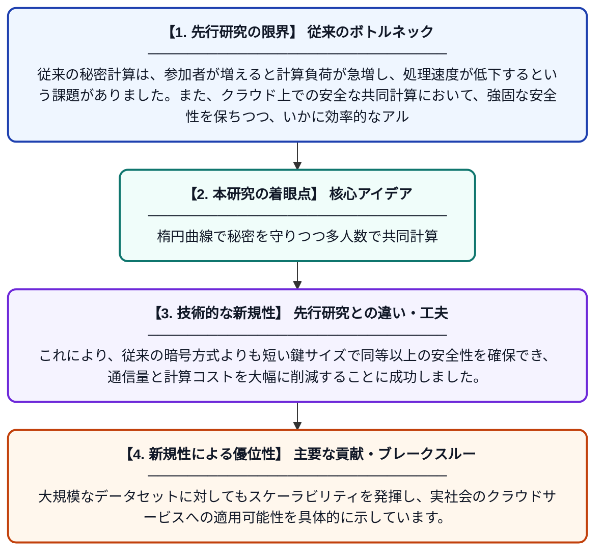

# 離散代数構造上の楕円曲線暗号に基づく安全な秘密計算

**Original Title**: *Elliptic curve cryptography based secure multi-party computation over discrete algebraic structures*

> **💡 一言要約**: 楕円曲線で秘密を守りつつ多人数で共同計算

| 項目 | 内容 |
|---|---|
| **著者** | MS Koban, SS Gadadhe, D Yewale, KS Gadgil |
| **掲載誌** | Journal of Discrete Mathematical … 2026 |
| **アラートキーワード** | Secure Computing |
| **原文リンク** | [https://tarupublications.com/journals/jdmsc/volume/29/issue/9-B/elliptic-curve-cryptography-based-secure-multi-party-computation-over-discrete-algebraic-structures](https://tarupublications.com/journals/jdmsc/volume/29/issue/9-B/elliptic-curve-cryptography-based-secure-multi-party-computation-over-discrete-algebraic-structures) |
| **PDF版要約** | [README.pdf](./README.pdf) |

---

## 📊 新規性の図解（先行研究との違いと本研究のブレークスルー）

## 📝 要約

互いに信頼していない複数の参加者が、自身のデータを秘匿したまま共同で計算を行う秘密計算（MPC）の新しい手法を提案しています。楕円曲線暗号と離散代数構造を組み合わせることで、大規模なグループやクラウド環境でも実用的なセキュリティと効率性を実現しました。

## ❓ どんな問題に取り組んだか

従来の秘密計算は、参加者が増えると計算負荷が急増し、処理速度が低下するという課題がありました。また、クラウド上での安全な共同計算において、強固な安全性を保ちつつ、いかに効率的なアルゴリズムを構築するかが求められていました。

## ✨ 何が新しい？何がすごい？（新規性）

本研究の最大の特徴は、離散代数構造における楕円曲線暗号を秘密計算に統合した点にあります。これにより、従来の暗号方式よりも短い鍵サイズで同等以上の安全性を確保でき、通信量と計算コストを大幅に削減することに成功しました。大規模なデータセットに対してもスケーラビリティを発揮し、実社会のクラウドサービスへの適用可能性を具体的に示しています。

## 🎓 大学1年生向けの解説

例えば、友達数人と「誰が一番お小遣いを持っているか」を知りたいけれど、自分の金額は誰にも教えたくないという場面を考えてみてください。この研究は、そんな風に「中身を秘密にしたまま、答えだけを正しく出す」ための数学的な仕組みを作ったものです。楕円曲線という高度な図形の性質を使うことで、たくさんの人が参加しても素早く、かつ絶対にバレないように計算できるのがすごいところです。
