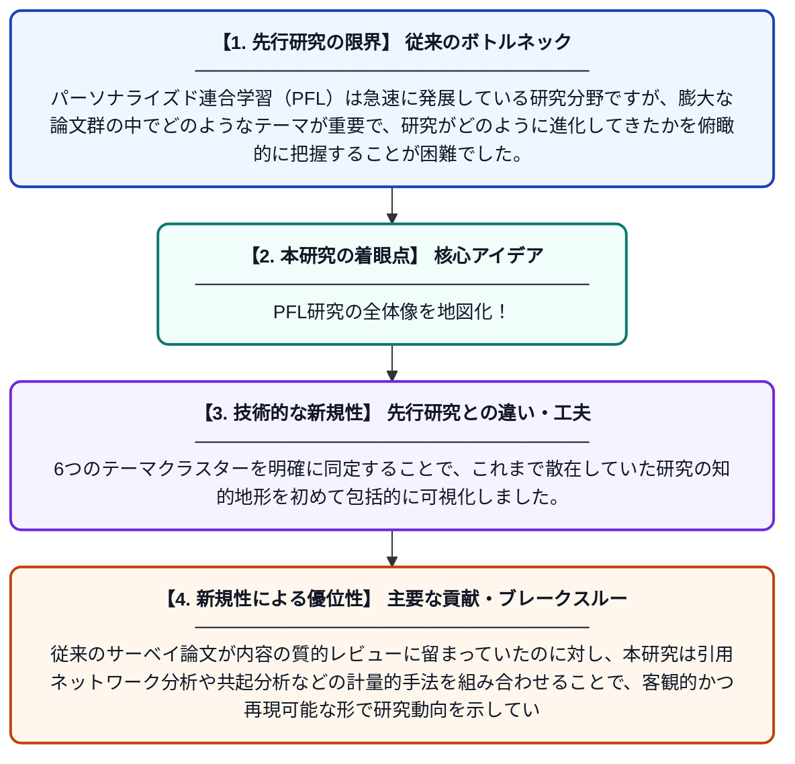

# パーソナライズド連合学習の知的地形図：書誌計量分析

**Original Title**: *Mapping the Intellectual Landscape of Personalized Federated Learning: A Bibliometric Analysis*

> **💡 一言要約**: PFL研究の全体像を地図化！

| 項目 | 内容 |
|---|---|
| **著者** | F Sabah, Y Chen, Y Zhen, M Azam, N Ahmad |
| **掲載誌** | SN Computer Science 2026 |
| **アラートキーワード** | Federated Learning |
| **原文リンク** | [https://link.springer.com/article/10.1007/s42979-026-05201-3](https://link.springer.com/article/10.1007/s42979-026-05201-3) |
| **PDF版要約** | [README.pdf](./README.pdf) |

---

## 📊 新規性の図解（先行研究との違いと本研究のブレークスルー）

## 📝 要約

本研究は、パーソナライズド連合学習（PFL）に関する1,204本の論文を対象に、書誌計量分析とテーマ分析を実施したものです。ネットワーク分析により「連合学習」「パーソナライゼーション」などを中心とした6つのテーマクラスターを特定しました。この分野の知的構造・研究動向・主要テーマを体系的に可視化し、今後の研究方向性を示しています。

## ❓ どんな問題に取り組んだか

パーソナライズド連合学習（PFL）は急速に発展している研究分野ですが、膨大な論文群の中でどのようなテーマが重要で、研究がどのように進化してきたかを俯瞰的に把握することが困難でした。個々の論文を読むだけでは、分野全体の知的構造や研究トレンドを体系的に理解することができないという課題がありました。

## ✨ 何が新しい？何がすごい？（新規性）

本研究は1,204本という大規模なPFL論文コーパスを対象に、書誌計量学的手法を用いて分野全体を定量的・体系的にマッピングした点が新しいです。6つのテーマクラスターを明確に同定することで、これまで散在していた研究の知的地形を初めて包括的に可視化しました。従来のサーベイ論文が内容の質的レビューに留まっていたのに対し、本研究は引用ネットワーク分析や共起分析などの計量的手法を組み合わせることで、客観的かつ再現可能な形で研究動向を示しています。

## 🎓 大学1年生向けの解説

「連合学習」とは、皆さんのスマートフォンのデータを外部に送らずに、端末上でAIを学習させる技術です。しかし、人によって使い方やデータが違うため、全員に同じAIを使うのではなく、それぞれに合わせた「パーソナライズ」が必要になります。この論文は、そのパーソナライズド連合学習に関する1,000本以上の研究論文を分析して、どんなテーマが研究されているかを地図のように整理したものです。膨大な研究の全体像を一気に把握できるため、これから研究を始める人が「どこから手をつければよいか」を知るのに非常に役立ちます。
