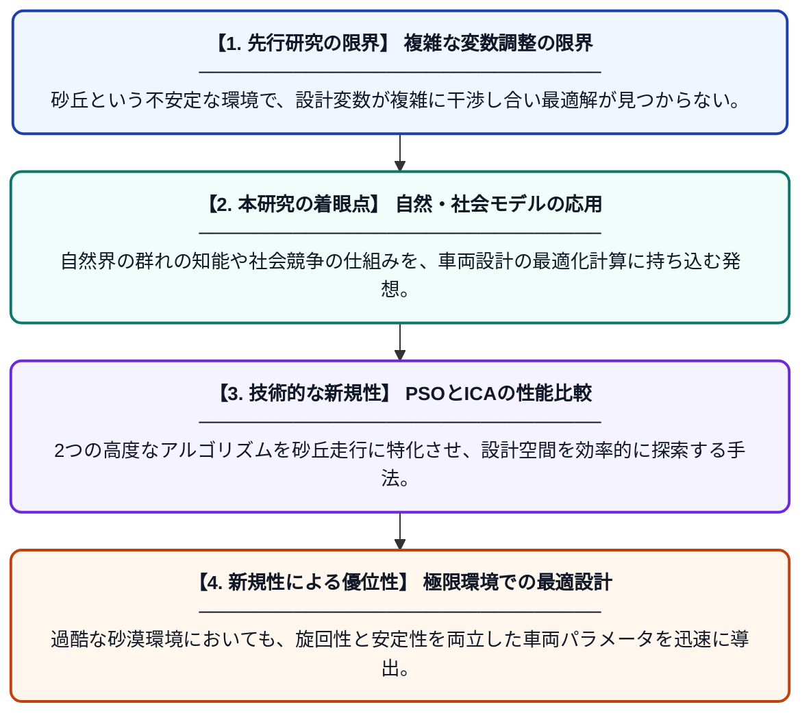

# PSOとICAを用いたサマラユカ砂丘におけるオフロード車両の操縦性パラメータのメタヒューリスティック最適化

**Original Title**: *Metaheuristic Optimization of Off-Road Vehicle Maneuverability Parameters in the Samalayuca Dunes Using PSO and ICA*

> **💡 一言要約**: 砂丘を走る車両の操縦性をAI手法で最適化

| 項目 | 内容 |
|---|---|
| **著者** | G Mejía, S Ramos, A Ochoa, U Ponce, D Al-mazo… |
| **掲載誌** | … International Conference on … 2026 |
| **アラートキーワード** | ICA |
| **原文リンク** | [https://link.springer.com/chapter/10.1007/978-3-032-44191-1_21](https://link.springer.com/chapter/10.1007/978-3-032-44191-1_21) |
| **PDF版要約** | [README.pdf](./README.pdf) |

---

## 📊 新規性の図解（先行研究との違いと本研究のブレークスルー）

## 📝 要約

サマラユカ砂丘のような過酷な環境におけるオフロード車両の操縦性を向上させるため、粒子群最適化（PSO）と帝国主義競争アルゴリズム（ICA）を用いた最適化手法を提案しています。旋回半径、加速、安定性、重量といった複雑に絡み合う設計変数を調整し、最適な車両性能を導き出すことに成功しました。

## ❓ どんな問題に取り組んだか

砂漠などの複雑な地形では、車両の旋回性能、加速力、安定性、重量といった設計変数が互いに干渉し合うため、手動で最適なバランスを見つけることは極めて困難です。特にサマラユカ砂丘のような不安定な地盤において、これらの要素を同時に最適化する効率的な手法が不足していました。

## ✨ 何が新しい？何がすごい？（新規性）

本研究は、生物の群れを模したPSOと、社会的な競争を模したICAという2つの異なるメタヒューリスティックアルゴリズムをオフロード車両の設計に適用した点が独創的です。従来の単一的な評価ではなく、砂丘特有の物理的制約を考慮した多目的最適化を行い、各アルゴリズムの有効性を比較検証しました。これにより、極限環境における車両設計の新たな工学的アプローチを確立しました。

## 🎓 大学1年生向けの解説

砂漠の砂山（砂丘）を走るバギーのような車を、どうすれば「もっと曲がりやすく、かつ転びにくく」作れるかを計算で解き明かす研究です。車の重さや加速の強さを変えると他の性能に影響してしまう難しいパズルを、生き物の群れの動きなどをヒントにした賢い計算方法（AIの仲間）を使って解きました。この研究によって、厳しい砂漠でも安全でスムーズに走れる車の設計がこれまでよりずっと正確にできるようになります。
