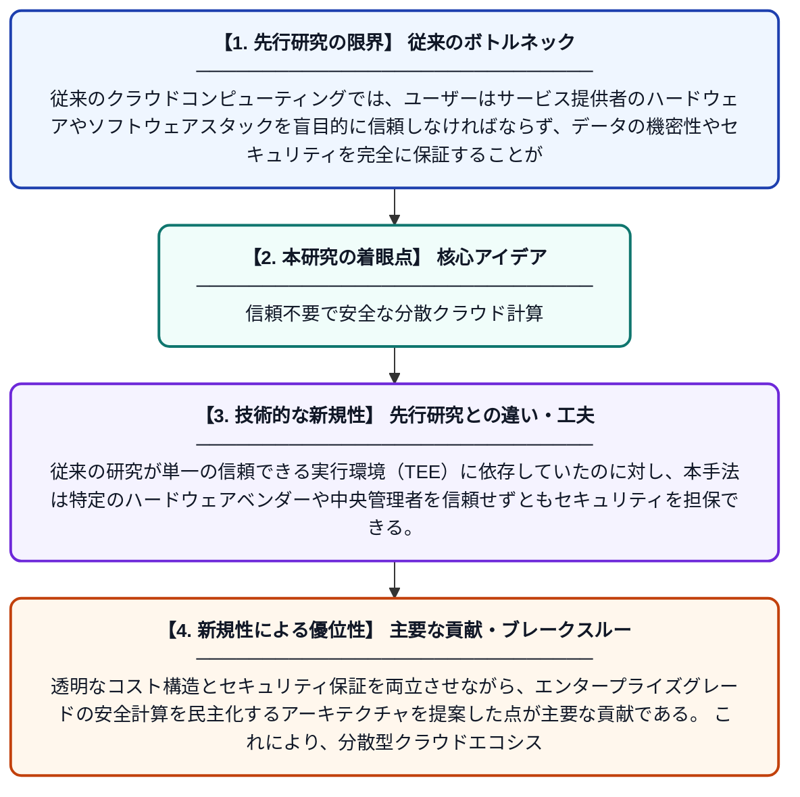

# Intel TDXと暗号化CVMを用いた信頼できないハードウェア上での分散コンピューティング

**Original Title**: *Decentralized Compute on Untrusted Hardware Using Intel TDX and Encrypted CVMs*

> **💡 一言要約**: 信頼不要で安全な分散クラウド計算

| 項目 | 内容 |
|---|---|
| **著者** | V Patidar, D Bindra, A Darwich, J Brown, H Xia, S Nair |
| **掲載誌** | arXiv preprint arXiv … 2026 |
| **アラートキーワード** | Secure Computing |
| **PDF** | [https://arxiv.org/pdf/2607.21865](https://arxiv.org/pdf/2607.21865) |
| **原文リンク** | [https://arxiv.org/pdf/2607.21865](https://arxiv.org/pdf/2607.21865) |
| **PDF版要約** | [README.pdf](./README.pdf) |

---

## 📊 新規性の図解（先行研究との違いと本研究のブレークスルー）

## 📝 要約

本論文は、信頼できないハードウェア上でも安全に計算を実行するための分散型機密コンピューティング基盤を提案する。Intel TDX（Trust Domain Extensions）と暗号化された機密仮想マシン（CVM）を組み合わせることで、独立した複数のノードにまたがる機密コンピューティングスタックの分散化を実現する。これにより、エンタープライズグレードの安全な計算能力への民主的なアクセスと透明なコスト構造を提供する。

## ❓ どんな問題に取り組んだか

従来のクラウドコンピューティングでは、ユーザーはサービス提供者のハードウェアやソフトウェアスタックを盲目的に信頼しなければならず、データの機密性やセキュリティを完全に保証することが難しかった。また、機密コンピューティング技術は特定の中央集権的なプロバイダに依存しており、コストが高く、一般ユーザーや中小企業には利用障壁が大きかった。信頼できないハードウェア上で安全かつ検証可能な計算を実現する分散的なアプローチが求められていた。

## ✨ 何が新しい？何がすごい？（新規性）

本研究の最大の新規性は、機密コンピューティングスタック自体を分散化し、複数の独立したノードにまたがってIntel TDXと暗号化CVMを活用する点にある。従来の研究が単一の信頼できる実行環境（TEE）に依存していたのに対し、本手法は特定のハードウェアベンダーや中央管理者を信頼せずともセキュリティを担保できる。透明なコスト構造とセキュリティ保証を両立させながら、エンタープライズグレードの安全計算を民主化するアーキテクチャを提案した点が主要な貢献である。これにより、分散型クラウドエコシステムにおける機密コンピューティングの実用化に向けた新たな道筋を示している。

## 🎓 大学1年生向けの解説

みなさんがスマホのデータをクラウド（インターネット上のサーバー）に保存するとき、そのサーバーを管理する会社を「信頼」しなければなりません。でも、もしその会社が不正をしたり、ハッカーに狙われたりしたらどうでしょう？この研究は、サーバーを管理する会社を信頼しなくても、データを安全に処理できる仕組みを作ることを目指しています。Intelの特別なチップ技術を使って、データを暗号化したまま計算し、しかもそれを一か所に集中させず多くのコンピュータに分散させることで、誰も不正にデータを覗けなくします。これにより、大企業だけでなく普通の人や小さな会社でも、安全で低コストなクラウド計算が使えるようになることを目指しています。
