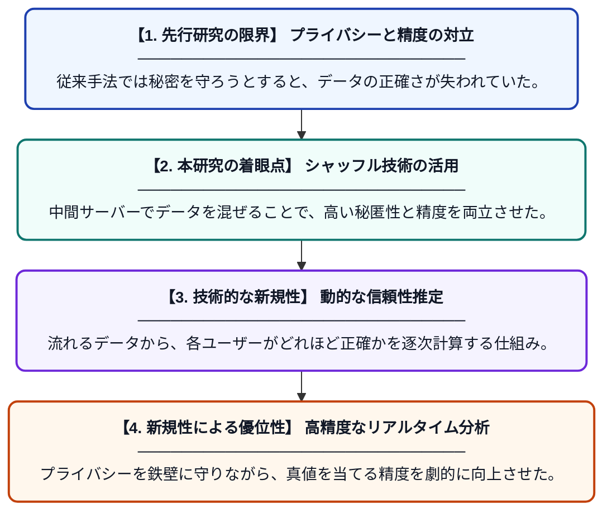

# シャッフル型差分プライバシーを用いたデータストリーム上の信頼性考慮型プライバシー保護真値発見

**Original Title**: *Credibility-Aware Privacy-Preserving Truth Discovery over Data Streams via Shuffled Differential Privacy*

> **💡 一言要約**: 秘密を守りつつ、流れるデータから真実を正確に見抜く

| 項目 | 内容 |
|---|---|
| **著者** | J Huang, Y Li, X Du, Z Bao, Z Mao, Y Huang |
| **掲載誌** | IEEE Internet of Things Journal 2026 |
| **アラートキーワード** | differential privacy |
| **原文リンク** | [https://ieeexplore.ieee.org/abstract/document/11780698/](https://ieeexplore.ieee.org/abstract/document/11780698/) |
| **PDF版要約** | [README.pdf](./README.pdf) |

---

## 📊 新規性の図解（先行研究との違いと本研究のブレークスルー）

## 📝 要約

IoT機器などのデータストリームから、ユーザーのプライバシーを保護しつつ正確な情報を抽出する「真値発見」の手法を提案しています。従来のローカル差分プライバシーが抱えていた精度とプライバシーのトレードオフを、シャッフル型差分プライバシー（SDP）を用いることで解決しています。

## ❓ どんな問題に取り組んだか

IoTデータから真実を特定する際、個人の秘密を守るためにデータを加工すると、情報の精度が著しく低下するという課題がありました。また、データが次々と送られてくるストリーム環境において、情報の提供者ごとの信頼性を考慮しながらプライバシーを守ることは困難でした。

## ✨ 何が新しい？何がすごい？（新規性）

本研究は、シャッフル型差分プライバシー（SDP）を真値発見に導入し、従来のローカル差分プライバシーよりも高い精度と強固なプライバシー保護を両立させました。さらに、データの時間的変化に対応しつつユーザーの信頼性を動的に推定するアルゴリズムを開発した点が革新的です。これにより、匿名化されたノイズ混じりのデータ群からでも、効率的かつ正確に真実の値を導き出すことが可能になりました。

## 🎓 大学1年生向けの解説

インターネット上のたくさんのセンサーやスマホから送られてくる情報には、間違いや嘘が含まれていることがあります。この研究は、誰が送ったかという秘密をしっかり守りつつ、バラバラになった情報の中から「何が本当か」を正しく当てる技術です。トランプをシャッフルするようにデータを混ぜる特別な仕組みを使うことで、プライバシーを守ることと、正しい答えを出すことの両方を100点満点に近づけました。
