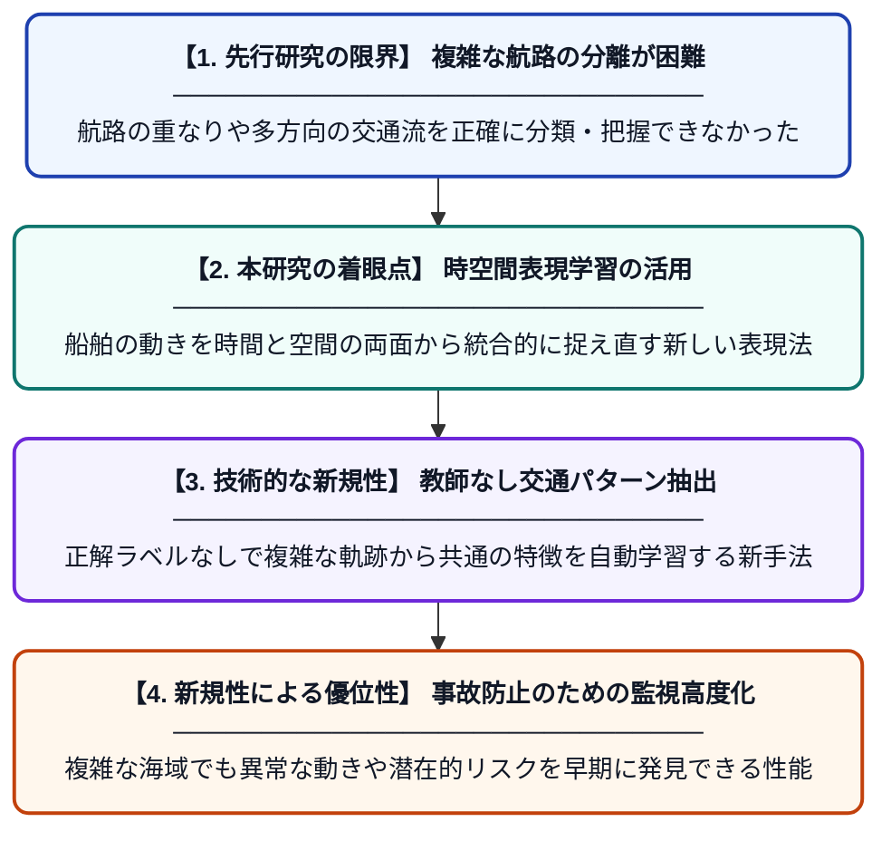

# 時空間軌跡表現学習による、安全性重視の教師なし船舶交通パターンマイニング

**Original Title**: *Safety-oriented unsupervised ship traffic pattern mining via spatiotemporal trajectory representation learning*

> **💡 一言要約**: 複雑な海域の船舶ルートをAIで自動解明

| 項目 | 内容 |
|---|---|
| **著者** | D Xu, J Yang, Y Qi, CG Soares |
| **掲載誌** | Reliability Engineering & System Safety 2026 |
| **アラートキーワード** | representation learning |
| **原文リンク** | [https://www.sciencedirect.com/science/article/pii/S0951832026015929](https://www.sciencedirect.com/science/article/pii/S0951832026015929) |
| **PDF版要約** | [README.pdf](./README.pdf) |

---

## 📊 新規性の図解（先行研究との違いと本研究のブレークスルー）

## 📝 要約

複雑な海域における交通安全モニタリングのため、軌跡表現学習を用いた教師なしの船舶交通パターン抽出手法を提案しました。この手法は、多方向の交通流や複雑な航路構造、および航路の空間的な重なりといった課題を解決することを目的としています。

## ❓ どんな問題に取り組んだか

複雑な海域では、船舶が複数の方向に進んだり、異なる航路が空間的に重なり合ったりするため、交通パターンを正確に把握することが困難です。従来の監視手法では、こうした複雑な挙動を自動的かつ高精度に分類し、安全管理に役立てることは容易ではありませんでした。

## ✨ 何が新しい？何がすごい？（新規性）

本研究は、船舶の軌跡を時間と空間の両面から学習する「表現学習」を取り入れることで、ラベルなしデータから自動でパターンを抽出する手法を開発しました。従来の単純なクラスタリングでは困難だった、空間的に重なり合う航路を高度な特徴抽出により明確に分離可能にしています。安全性に特化した設計により、潜在的なリスク把握や交通管理の自動化に直接貢献できる点が画期的です。

## 🎓 大学1年生向けの解説

広い海では船が通る「道」が決まっていますが、入り組んだ場所では多くの船の通り道が重なり、非常に混雑します。この研究は、船が通った「足跡（軌跡）」のデータをAIに読み込ませて、どのようなパターンで船が動いているかを自動で見つけ出す技術を作りました。人間が手作業で調べなくても、AIが「ここは主要な道」「ここは危険な場所」と賢く分類してくれます。これによって、船の衝突事故を未然に防ぐための高度な交通ルール作りが可能になります。
