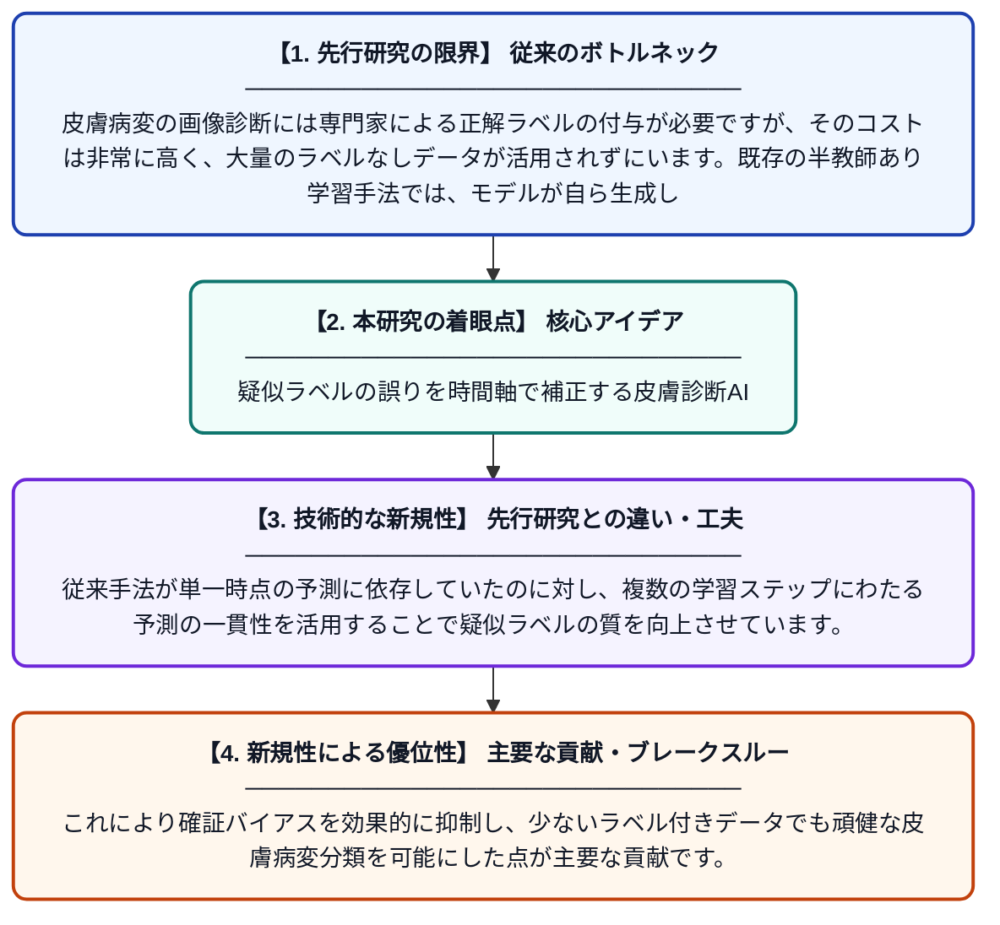

# 半教師あり皮膚病変分類のための多段階時間的安定化手法

**Original Title**: *Multi-level temporal stabilization for semi-supervised skin lesion classification*

> **💡 一言要約**: 疑似ラベルの誤りを時間軸で補正する皮膚診断AI

| 項目 | 内容 |
|---|---|
| **著者** | K Santhanakrishnan, S Manivannan, RG Ragel |
| **掲載誌** | Neurocomputing 2026 |
| **アラートキーワード** | Semi supervise |
| **原文リンク** | [https://www.sciencedirect.com/science/article/pii/S0925231226019946](https://www.sciencedirect.com/science/article/pii/S0925231226019946) |
| **PDF版要約** | [README.pdf](./README.pdf) |

---

## 📊 新規性の図解（先行研究との違いと本研究のブレークスルー）

## 📝 要約

本論文は、皮膚科画像（ダーモスコピー画像）の分類における半教師あり学習の課題に取り組む研究です。専門家によるアノテーションが限られた状況で、ノイズの多い疑似ラベルによる確証バイアスを抑制するため、多段階の時間的安定化メカニズムを提案しています。これにより、少量のラベル付きデータから高精度な皮膚病変分類を実現します。

## ❓ どんな問題に取り組んだか

皮膚病変の画像診断には専門家による正解ラベルの付与が必要ですが、そのコストは非常に高く、大量のラベルなしデータが活用されずにいます。既存の半教師あり学習手法では、モデルが自ら生成した誤った疑似ラベルを信じ込む「確証バイアス」が発生し、分類精度が低下するという問題がありました。

## ✨ 何が新しい？何がすごい？（新規性）

本研究は、学習過程の複数の時間的段階においてモデルの予測を安定化させる「多段階時間的安定化」という新しいアプローチを提案しています。従来手法が単一時点の予測に依存していたのに対し、複数の学習ステップにわたる予測の一貫性を活用することで疑似ラベルの質を向上させています。これにより確証バイアスを効果的に抑制し、少ないラベル付きデータでも頑健な皮膚病変分類を可能にした点が主要な貢献です。

## 🎓 大学1年生向けの解説

病院で皮膚の写真を見て病気を診断するAIを作るには、医師が「これは病気A」と正解を教えた大量の写真が必要ですが、それには多大なコストがかかります。そこで、正解のない写真も活用する「半教師あり学習」という方法が使われますが、AIが自分で付けた間違いの答えを信じ込んでしまう問題がありました。この研究では、学習の異なる時間的段階でAIの予測を比べて一貫性を確認することで、その間違いを減らす仕組みを作りました。料理のレシピを複数の段階でチェックして失敗を防ぐイメージです。これにより、少ない正解データでも高精度に皮膚病変を分類できるようになりました。
