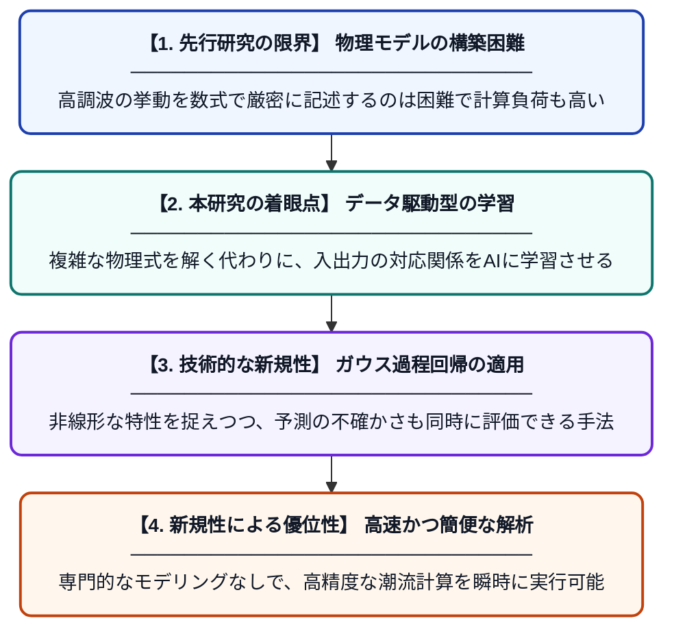

# ガウス過程回帰に基づく高調波潮流写像モデル

**Original Title**: *Harmonic Power Flow Mapping Model Based on Gaussian Process Regression*

> **💡 一言要約**: AIで高調波計算を高速・簡略化する新モデル

| 項目 | 内容 |
|---|---|
| **著者** | Y Chen, Y Wang, X Xiao |
| **掲載誌** | 22nd International Conference on Harmonics & … 2026 |
| **アラートキーワード** | gaussian process |
| **原文リンク** | [https://ieeexplore.ieee.org/abstract/document/11756279/](https://ieeexplore.ieee.org/abstract/document/11756279/) |
| **PDF版要約** | [README.pdf](./README.pdf) |

---

## 📊 新規性の図解（先行研究との違いと本研究のブレークスルー）

## 📝 要約

従来の高調波潮流計算（HPF）における複雑なモデリングと膨大な計算負荷を解消するため、ガウス過程回帰（GPR）を用いたデータ駆動型の写像モデルを提案しています。このモデルにより、物理的な詳細モデルを構築することなく、系統内の高調波の挙動を効率的かつ高精度に推定することが可能になりました。

## ❓ どんな問題に取り組んだか

電力系統における高調波潮流計算は、非線形デバイスの増加により計算が極めて複雑になり、詳細な物理モデルの構築には膨大な時間と専門知識が必要でした。また、従来の数値計算手法では、大規模なネットワークにおいて計算コストが爆発的に増大するという課題がありました。

## ✨ 何が新しい？何がすごい？（新規性）

物理的な方程式を直接解く代わりに、ガウス過程回帰（GPR）を用いて入力データと出力結果の間の非線形な関係を直接学習する「写像モデル」を構築した点が画期的です。これにより、煩雑なパラメータ設定を回避しながら、不確実性を考慮した確率的な出力（回帰結果）を得ることが可能になりました。先行研究と比較して、モデル構築の手間を大幅に削減しつつ、計算の高速化と高い予測精度を両立させています。

## 🎓 大学1年生向けの解説

電気の通り道には「高調波」というノイズのような波が混ざることがあり、これが原因で電化製品が壊れることがあります。これまでは、このノイズがどこにどれくらい流れるかを調べるために、とても難しい数学の式をたくさん解く必要がありました。この研究では、AIの一種（ガウス過程回帰）を使うことで、難しい式を使わずにノイズの流れをパッと予測する方法を開発しました。これによって、より安定的でクリーンな電気を届けるための計算が、従来よりもずっと簡単になります。
