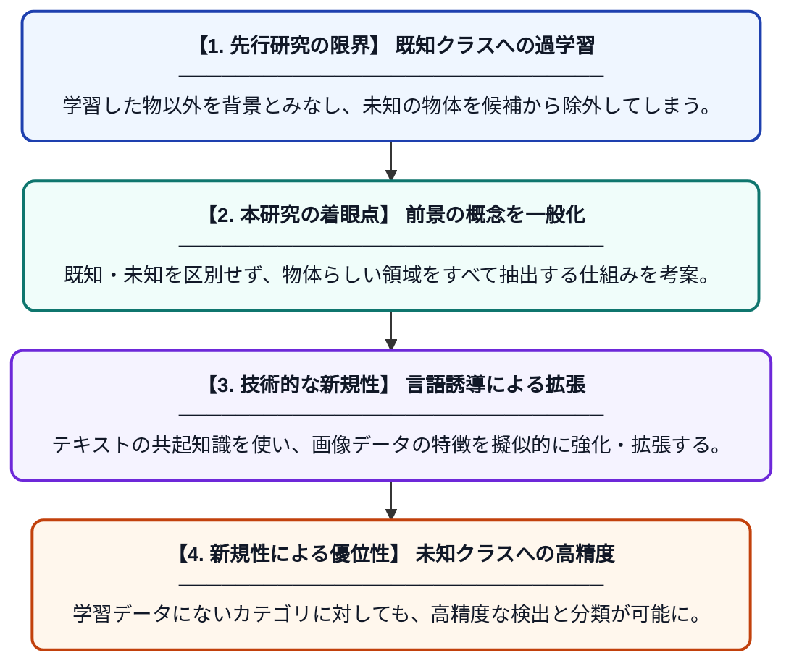

# 前景汎用化RPNと言語誘導型視覚拡張によるオープン語彙物体検出

**Original Title**: *Foreground-Generalized RPN and Language-Guided Visual Augmentation for Open-Vocabulary Object Detection*

> **💡 一言要約**: 未知の物体も賢く見抜く！言語で導く次世代検出技術

| 項目 | 内容 |
|---|---|
| **著者** | Q Liang, Y Zhang |
| **掲載誌** | Proceedings of the 34th ACM International Conference … 2026 |
| **アラートキーワード** | Open-Vocabulary Object ... |
| **原文リンク** | [https://dl.acm.org/doi/abs/10.1145/3767308.3834985](https://dl.acm.org/doi/abs/10.1145/3767308.3834985) |
| **PDF版要約** | [README.pdf](./README.pdf) |

---

## 📊 新規性の図解（先行研究との違いと本研究のブレークスルー）

## 📝 要約

学習時に存在しない未知の物体を検出するために、物体の候補領域を抽出するRPNの汎用化と言語知識を活用したデータ拡張を提案した研究です。視覚情報と言語情報の共起関係を橋渡しすることで、オープン語彙における検出精度を大幅に向上させました。

## ❓ どんな問題に取り組んだか

従来の物体検出モデルは学習データに含まれる特定のカテゴリに依存しすぎており、未知の物体を「背景」として見逃す傾向がありました。また、画像とテキストの結びつきが弱く、見たことがない物体の名前を正しく推測するのが困難でした。

## ✨ 何が新しい？何がすごい？（新規性）

本研究は、既知・未知を問わず物体を抽出できる「Foreground-Generalized RPN」を導入した点が画期的です。さらに、言語モデルの知識を借りて視覚的な特徴を補う「Language-Guided Visual Augmentation」により、視覚とテキストの対応関係を強化しました。これにより、先行研究を凌駕する高い汎化性能を実現しています。

## 🎓 大学1年生向けの解説

AIに「犬」と「猫」だけを教えても、外で「タヌキ」を見たら無視してしまいます。この研究は、AIに「何か形があるものは全部チェックしよう」という広い視野を持たせ、さらに言葉の知識を使って「これはタヌキに近いぞ」と予想させる技術です。これにより、一度も写真を見たことがない珍しい物でも正しく見つけられるようになります。
