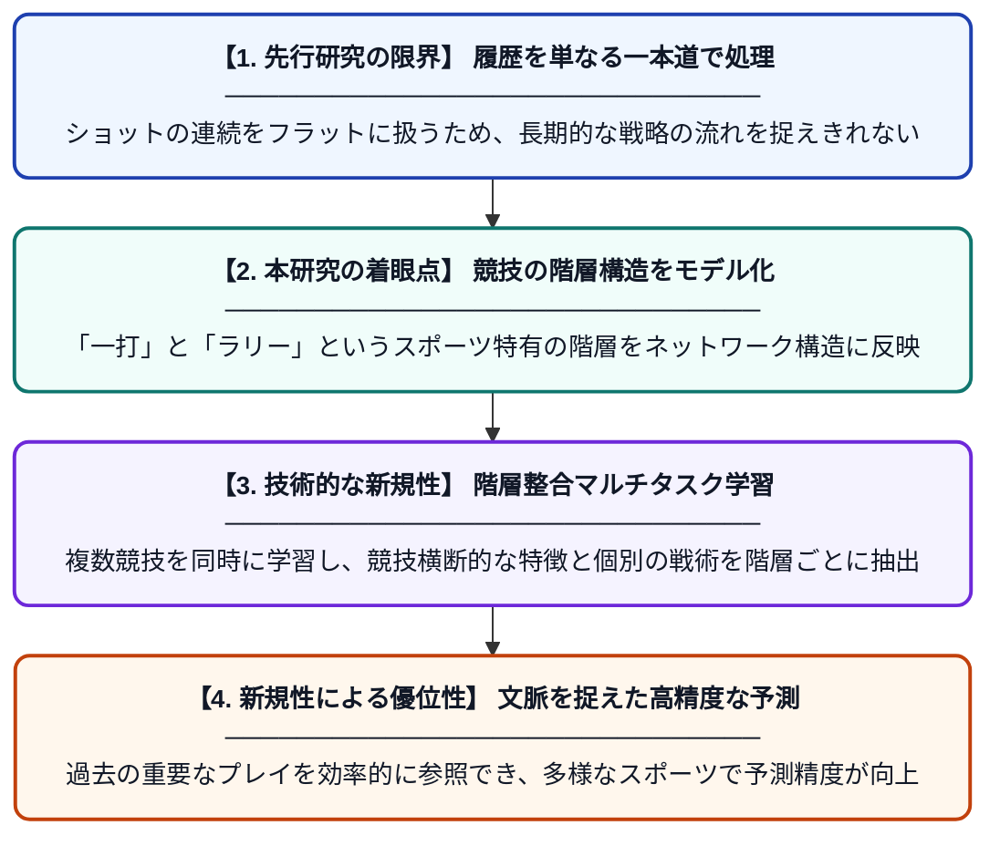

# 1つの階層、多くのスポーツ：次打予測のための階層整合型マルチタスク学習

**Original Title**: *One Hierarchy, Many Sports: Hierarchy-Aligned Multi-Task Learning for Next-Shot Prediction*

> **💡 一言要約**: 階層構造でスポーツの「次の一手」を予測！

| 項目 | 内容 |
|---|---|
| **著者** | CW Cai, MT Sun, SK Wu, HH Chen |
| **掲載誌** | arXiv preprint arXiv:2611.15529 2026 |
| **アラートキーワード** | one shot |
| **PDF** | [https://arxiv.org/pdf/2611.15529](https://arxiv.org/pdf/2611.15529) |
| **Git リポジトリ** | [https://github.com/gndd1221/For-Sports-event-modeling-with-rally-and-score-hierarchical-A-Mul](https://github.com/gndd1221/For-Sports-event-modeling-with-rally-and-score-hierarchical-A-Mul) |
| **原文リンク** | [https://arxiv.org/pdf/2611.15529](https://arxiv.org/pdf/2611.15529) |
| **PDF版要約** | [README.pdf](./README.pdf) |

---

## 📊 新規性の図解（先行研究との違いと本研究のブレークスルー）

## 📝 要約

スポーツ競技における「次のショット」を予測するため、打球単位とラリー単位の情報を整理して処理する階層的なモデルを提案しました。複数のスポーツにまたがるデータを共通の階層構造で扱うマルチタスク学習により、過去の試合展開をより正確に反映した予測が可能になります。

## ❓ どんな問題に取り組んだか

従来の予測モデルは、過去の打球履歴を単一の長い列（フラットな構造）として扱っていたため、ショット間の局所的な関係とラリー全体の文脈を区別して理解することが困難でした。また、異なる競技特性を一つのモデルで効果的に統合する手法も不足していました。

## ✨ 何が新しい？何がすごい？（新規性）

本研究の核心は、ショットとラリーの二重構造を明示的に取り込んだ「階層整合型マルチタスク学習」にあります。従来のフラットなTransformerモデルとは異なり、階層的な注意機構（Attention）を用いることで、膨大な履歴の中から現在の状況に最も関連する過去のプレイを効率的に抽出できます。これにより、バドミントンやテニスといった異なるスポーツ間での共通の戦術パターンと、各競技固有の特性を同時に学習することに成功しました。

## 🎓 大学1年生向けの解説

スポーツの試合で「次に選手がどこへ、どんな球を打つか」をAIで当てる研究です。テニスやバドミントンは、一打ずつのやり取りが集まって一つの得点（ラリー）になるという「階層的な構造」を持っています。この研究では、その構造をそのままAIの仕組みに取り入れることで、過去の似たような場面を賢く思い出し、未来をより正確に予想できるようにしました。色々なスポーツのデータをまとめて学習させることで、スポーツ全般に共通する『勝ち筋』も捉えられるようになっています。
