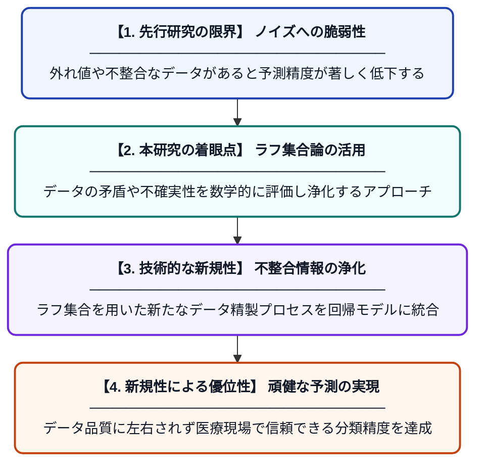

# 不整合情報の浄化に基づくラフ・ロジスティック回帰モデル

**Original Title**: *Rough-Logistics Regression Model Based on Purifying Inconsistent Information*

> **💡 一言要約**: ラフ集合でノイズを浄化し回帰分析の精度を極める

| 項目 | 内容 |
|---|---|
| **著者** | I Rahmi, R Efendi, NA Samat, H Yozza |
| **掲載誌** | New Mathematics and Natural Computation 2026 |
| **アラートキーワード** | logistics |
| **原文リンク** | [https://www.worldscientific.com/doi/abs/10.1142/S1793005729500294](https://www.worldscientific.com/doi/abs/10.1142/S1793005729500294) |
| **PDF版要約** | [README.pdf](./README.pdf) |

---

## 📊 新規性の図解（先行研究との違いと本研究のブレークスルー）

## 📝 要約

医療分野のデータ解析で頻発する外れ値や矛盾したデータ（不整合情報）がロジスティック回帰の精度を下げてしまう問題を、ラフ集合論を用いて解決する新しいモデルを提案しました。データの不確実性を数学的に「浄化」してから解析を行うことで、ノイズの多い環境でも高い予測精度を実現しています。

## ❓ どんな問題に取り組んだか

医療研究で多用されるロジスティック回帰は、データ内の外れ値や矛盾した情報に対して非常に脆弱であるという課題があります。実世界のデータには不完全な情報や不整合が必然的に含まれるため、従来のモデルでは正確な予測や意思決定が困難になるケースが多く見られました。

## ✨ 何が新しい？何がすごい？（新規性）

本研究の最大の特徴は、ラフ集合論（Rough Set Theory）を導入してデータの不整合性を数学的に定義し、計算の前に情報を「浄化」するプロセスを統合した点にあります。先行研究が外れ値の影響を弱める手法に留まっていたのに対し、本モデルは情報の不確実性そのものを構造的に取り扱うアプローチを採用しました。これにより、汚れたデータセットに対しても極めて頑健で信頼性の高い分類パフォーマンスを発揮することが可能になりました。

## 🎓 大学1年生向けの解説

病気の診断予測などに使われる計算式は、実は「ちょっとした間違いデータ」が混ざるだけで結果がめちゃくちゃになってしまうことがあります。この研究では、「ラフ集合」という、あいまいな情報を扱うための数学を使って、計算の邪魔になるデータをお掃除する仕組みを作りました。掃除してから計算することで、完璧ではないデータからでも、正しく病気を見抜く力を高めることに成功したのです。
