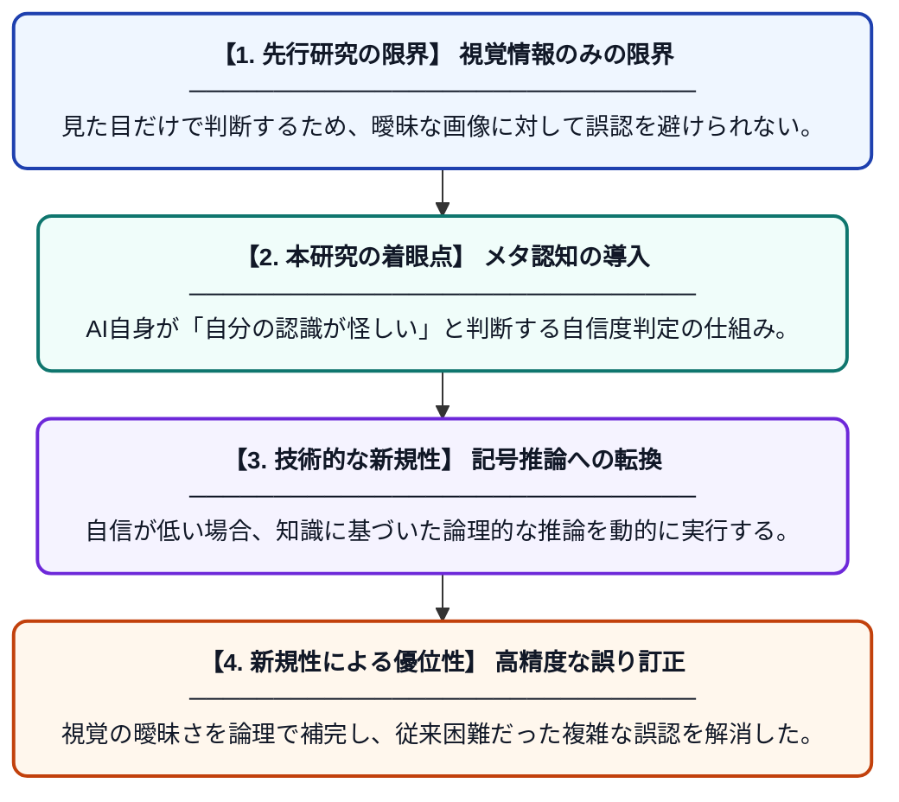

# 視覚的な曖昧さ解消のための根拠に基づいた推論

**Original Title**: *Grounded Reasoning for Visual Ambiguity Resolution*

> **💡 一言要約**: 迷った時だけ「考えて」視覚のミスを直すAI技術

| 項目 | 内容 |
|---|---|
| **著者** | J Brody, MD Nguyen |
| **掲載誌** | Proceedings of the AAAI Symposium Series 2026 |
| **アラートキーワード** | Open-Vocabulary Object ... |
| **PDF** | [https://ojs.aaai.org/index.php/AAAI-SS/article/download/43392/50951](https://ojs.aaai.org/index.php/AAAI-SS/article/download/43392/50951) |
| **原文リンク** | [https://ojs.aaai.org/index.php/AAAI-SS/article/download/43392/50951](https://ojs.aaai.org/index.php/AAAI-SS/article/download/43392/50951) |
| **PDF版要約** | [README.pdf](./README.pdf) |

---

## 📊 新規性の図解（先行研究との違いと本研究のブレークスルー）

## 📝 要約

視覚認識における誤りや曖昧さを修正するために、メタ認知的な記号推論を導入したシステムを提案しています。AIが自分の認識に自信がない場合にのみ推論プロセスを起動することで、視覚的な混乱を論理的に解決します。

## ❓ どんな問題に取り組んだか

従来の画像認識システムは、対象が重なっていたり不明瞭だったりする場合に誤判定を起こしやすく、その誤りを自己修正する手段を持っていませんでした。認識結果の不確実性を論理的な知識と結びつけて解消する仕組みが不足していました。

## ✨ 何が新しい？何がすごい？（新規性）

認識プロセスに「メタ認知（自分の認識状態の把握）」を取り入れ、自信度のしきい値によって記号的推論を動的に制御する点が斬新です。単なるパターンマッチングに留まらず、状況に応じた論理推論を視覚処理に統合することで、従来手法では修正できなかった文脈的な誤り訂正を実現しました。低レベルの視覚情報と高レベルの論理知識を効率的に融合させた点が主要な貢献です。

## 🎓 大学1年生向けの解説

AIが写真を見て「これは何だろう？」と迷ったときに、人間のように「周りの状況から考えると、これはAではなくBのはずだ」と論理的に考え直す仕組みを作った研究です。今までのAIは見えたものをそのまま信じるだけでしたが、この研究ではAIに「自分の判断に自信があるか」を確認させます。自信がないときだけ、蓄積された知識を使って推理することで、見間違いを大幅に減らすことができます。
